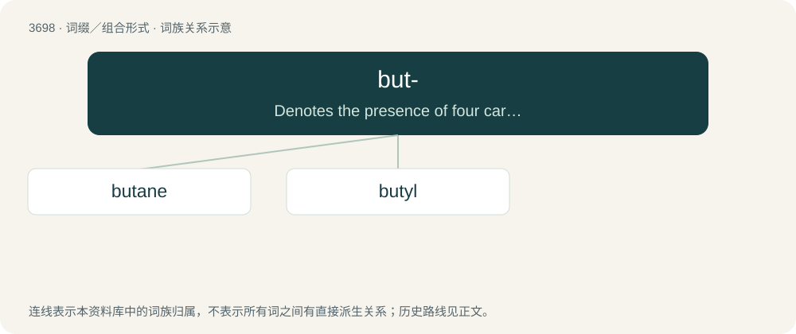

# 3743 · but- — Denotes the presence of four carbon atoms in the parent chain when forming names of organic compounds.

[总目录](../00_总目录_按常用程度.md)

**类型**：词缀／组合形式　｜　**来源语言**：见词源记录

## 核心含义与来源

- 核心含义：Denotes the presence of four carbon atoms in the parent chain when forming names of organic compounds.
- 英文含义：Denotes the presence of four carbon atoms in the parent chain when forming names of organic compounds.
- 词形：but-

**来源记录 1**（前缀／前置成分；Denotes the presence of four carbon atoms in the parent chain when forming names of organic compounds.）

From butyl. Ultimately from Ancient Greek βούτυρος (boúturos, “butter”).

## 词族图

## 单词速览（常用到不常用）

| 单词 | 音标 | 释义 |
|---|---|---|
| [butane](#w-1) | /ˈbjuːteɪn/ | n. 丁烷；\[医\] 丁烷 |
| [butyl](#w-2) | /ˈbjuːtɪl/ | n. 丁基；\[医\] 丁基 |

## 逐词详解

### 1. butane

**词性**：名词　｜　**音标**：/ˈbjuːteɪn/

**中文释义**：n. 丁烷；\[医\] 丁烷

**英文义项**：A hydrocarbon (either of the two isomers of C₄H₁₀, n-butane and 2-methylpropane) found in gaseous petroleum fractions. / The n-butane isomer only.

**构词拆分**：but- (“four carbon prefix”) + -ane (“alkane suffix”)

**例句**：

> We have to move the butane tank.

### 2. butyl

**词性**：名词　｜　**音标**：/ˈbjuːtɪl/

**中文释义**：n. 丁基；\[医\] 丁基

**英文义项**：Any of four isomeric univalent hydrocarbon radicals, C₄H₉, formally derived from butane by the loss of a hydrogen atom. / A synthetic rubber made by the polymerization of isobutylene.

**构词拆分**：but- + -yl

**词源与演化**：

From but- + -yl.
