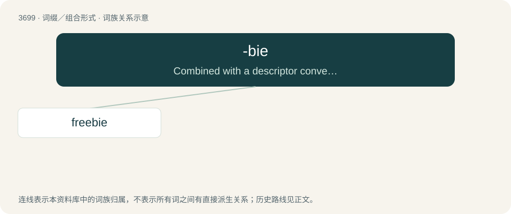

# 3744 · -bie — Combined with a descriptor conveying a characteristic (such as skill, experience, or social position) to form words for people.

[总目录](../00_总目录_按常用程度.md)

**类型**：词缀／组合形式　｜　**来源语言**：见词源记录

## 核心含义与来源

- 核心含义：Combined with a descriptor conveying a characteristic (such as skill, experience, or social position) to form words for people.
- 英文含义：Combined with a descriptor conveying a characteristic (such as skill, experience, or social position) to form words for people.
- 词形：-bie

**来源记录 1**（后缀／后置成分；Combined with a descriptor conveying a characteristic (such as skill, experience, or social position) to form words for people.）

From newbie.

## 词族图

## 单词速览（常用到不常用）

| 单词 | 音标 | 释义 |
|---|---|---|
| [freebie](#w-1) | /ˈfɹiːbi/ | n. 免费的东西；免费赠品（尤指戏院赠券） |

## 逐词详解

### 1. freebie

**词性**：名词　｜　**音标**：/ˈfɹiːbi/

**中文释义**：n. 免费的东西；免费赠品（尤指戏院赠券）

**英文义项**：Something which is free; a giveaway or handout.

**构词拆分**：free + -b- (epenthetic) + -ie；free + -bie

**词源与演化**：

From free + -b- (epenthetic) + -ie or free + -bie.

**例句**：

> I didn't buy a thing, but they were handing out some neat freebies and samples.

该用例对应义项：Something which is free; a giveaway or handout.
