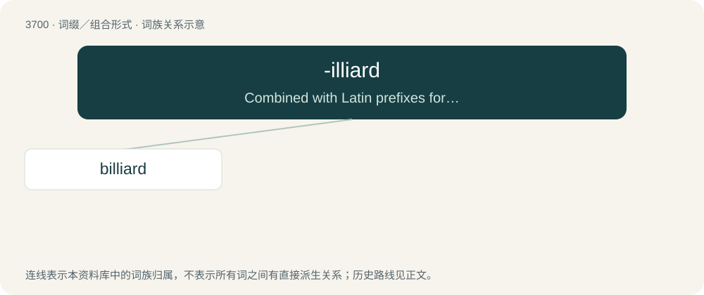

# 3745 · -illiard — Combined with Latin prefixes for names of integers in order to form names of large numbers as 10⁶ⁿ⁺³.

[总目录](../00_总目录_按常用程度.md)

**类型**：词缀／组合形式　｜　**来源语言**：见词源记录

## 核心含义与来源

- 核心含义：Combined with Latin prefixes for names of integers in order to form names of large numbers as 10⁶ⁿ⁺³.
- 英文含义：Combined with Latin prefixes for names of integers in order to form names of large numbers as 10⁶ⁿ⁺³.
- 词形：-illiard

**来源记录 1**（后缀／后置成分；Combined with Latin prefixes for names of integers in order to form names of large numbers as 10⁶ⁿ⁺³.）

From French -illiard.

## 词族图

## 单词速览（常用到不常用）

| 单词 | 音标 | 释义 |
|---|---|---|
| [billiard](#w-1) | /ˈbɪl.i.ɑː(ɹ)d/ | 【英文】10¹⁵, a thousand billion (long scale) or a million milliard. |

## 逐词详解

### 1. billiard

**词性**：数词　｜　**音标**：/ˈbɪl.i.ɑː(ɹ)d/

**英文义项**：10¹⁵, a thousand billion (long scale) or a million milliard.

**构词拆分**：bi- (“two”) + -illiard

**词源与演化**：

From French billiard, equivalent to bi- (“two”) + -illiard.
