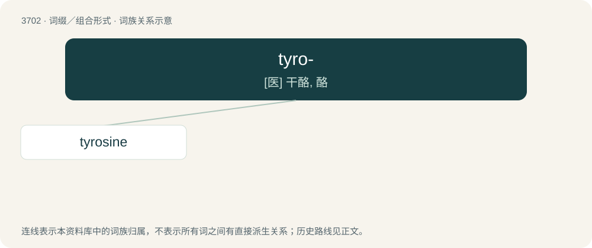

# 3746 · tyro- — \[医\] 干酪, 酪

[总目录](../00_总目录_按常用程度.md)

**类型**：词缀／组合形式　｜　**来源语言**：见词源记录

## 核心含义与来源

- 核心含义：\[医\] 干酪, 酪
- 英文含义：cheese
- 词形：tyro-

**来源记录 1**（前缀／前置成分；cheese）

From international scientific vocabulary, reflecting a New Latin combining form, from Ancient Greek τῡρός (tūrós, “cheese”).

## 词族图

## 单词速览（常用到不常用）

| 单词 | 音标 | 释义 |
|---|---|---|
| [tyrosine](#w-1) | /ˈtirəsiːn/ | n. 酪氨酸；\[化\] 酪氨酸; 3-对羟苯基丙氨酸 |

## 逐词详解

### 1. tyrosine

**词性**：名词　｜　**音标**：/ˈtirəsiːn/

**中文释义**：n. 酪氨酸；\[化\] 酪氨酸; 3-对羟苯基丙氨酸

**英文义项**：A nonessential amino acid 2-amino-3-(4-hydroxyphenyl)propanoic acid found in most animal proteins, especially casein

**构词拆分**：tyro- + -ine

**词源与演化**：

From Ancient Greek τῡρός (tūrós, “cheese”) + -ine (since first discovered in cheese); surface analysis is approximately tyro- + -ine.

**例句**：

> Tyrosine is similar in structure to phenylalanine, with the important distinction that the latter contains a hydroxyl group in its side chain.
