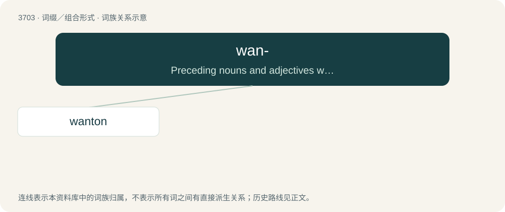

# 3747 · wan- — Preceding nouns and adjectives with the sense “bad”, “un-”.

[总目录](../00_总目录_按常用程度.md)

**类型**：词缀／组合形式　｜　**来源语言**：见词源记录

## 核心含义与来源

- 核心含义：Preceding nouns and adjectives with the sense “bad”, “un-”.
- 英文含义：Preceding nouns and adjectives with the sense “bad”, “un-”.
- 词形：wan-

**来源记录 1**（前缀／前置成分；Preceding nouns and adjectives with the sense “bad”, “un-”.）

From Middle English wan-, from Old English wan-, from Proto-West Germanic \*wana-, from Proto-Germanic \*wanaz (“lacking, missing, deficient”), from Proto-Indo-European \*h₁weh₂- (“to be lacking, be empty”).

## 词族图

## 单词速览（常用到不常用）

| 单词 | 音标 | 释义 |
|---|---|---|
| [wanton](#w-1) | 英 /ˈwɒntən/；美 /ˈwɑntən/ | n. 荡妇, 水性杨花的女人；a. 恶意的, 不负责任的, 无节制的, 嬉戏的, 繁茂的, 淫荡的；vi. 变化无常, 嬉戏, 闲荡, 放肆 |

## 逐词详解

### 1. wanton

**词性**：动词　｜　**音标**：英 /ˈwɒntən/；美 /ˈwɑntən/

**中文释义**：n. 荡妇, 水性杨花的女人；a. 恶意的, 不负责任的, 无节制的, 嬉戏的, 繁茂的, 淫荡的；vi. 变化无常, 嬉戏, 闲荡, 放肆

**英文义项**：To rove and ramble without restraint, rule, or limit; to revel; to play loosely; to frolic. / To waste or squander, especially in pleasure (most often with away).

**构词拆分**：wan- + towed

**词源与演化**：

From Middle English wantoun, wantowen, wantoȝen, wantowe (“uneducated; unrestrained; licentious; sportive; playful”), from wan- (“not, un-, mis-”) + towen, i-towen (“educated”, literally “towed; led; drawn”), from Old English togen, ġetogen, past participle of tēon (“to train, discipline”), equivalent to wan- + towed.

**例句**：

> The young man wantoned away his inheritance.

该用例对应义项：To waste or squander, especially in pleasure (most often with away).
