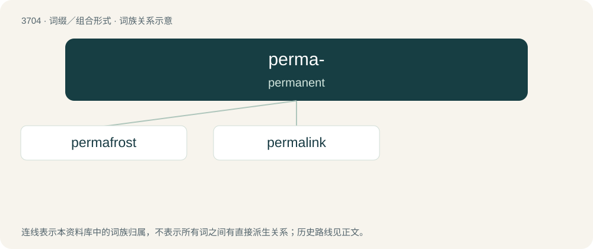

# 3748 · perma- — permanent

[总目录](../00_总目录_按常用程度.md)

**类型**：词缀／组合形式　｜　**来源语言**：见词源记录

## 核心含义与来源

- 核心含义：permanent
- 英文含义：permanent
- 词形：perma-

**来源记录 1**（前缀／前置成分；permanent）

Clipping of permanent.

## 词族图

## 单词速览（常用到不常用）

| 单词 | 音标 | 释义 |
|---|---|---|
| [permafrost](#w-1) | 英 /ˈpɜːməˌfɹɔst/；美 /ˈpɝməˌfɹɔst/ | n. \[地\]永久冻结带 |
| [permalink](#w-2) | 英 /ˈpɜː(ɹ).mə.lɪŋk/ | 【英文】A permanent (unchanging) link to an individual blog entry or news item on the World Wide Web. |

## 逐词详解

### 1. permafrost

**词性**：名词　｜　**音标**：英 /ˈpɜːməˌfɹɔst/；美 /ˈpɝməˌfɹɔst/

**中文释义**：n. \[地\]永久冻结带

**英文义项**：Permanently frozen ground, or a specific layer thereof.

**构词拆分**：perma- + frost

**词源与演化**：

From perma- + frost.

**例句**：

> The melting permafrost was key factor in the ecological disaster.

### 2. permalink

**词性**：名词　｜　**音标**：英 /ˈpɜː(ɹ).mə.lɪŋk/

**英文义项**：A permanent (unchanging) link to an individual blog entry or news item on the World Wide Web.

**构词拆分**：perma- + link

**词源与演化**：

From perma- + link.
