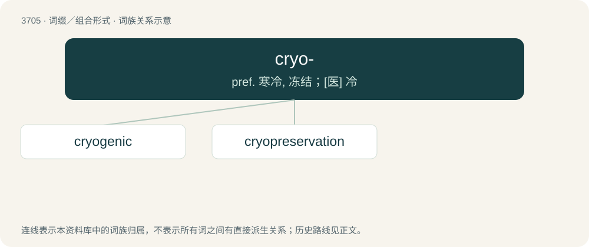

# 3749 · cryo- — pref. 寒冷, 冻结；\[医\] 冷

[总目录](../00_总目录_按常用程度.md)

**类型**：词缀／组合形式　｜　**来源语言**：见词源记录

## 核心含义与来源

- 核心含义：pref. 寒冷, 冻结；\[医\] 冷
- 英文含义：cold, freezing
- 词形：cryo-

**来源记录 1**（前缀／前置成分；cold, freezing）

Learned borrowing from Ancient Greek κρῠ́ος (krŭ́os, “ice, icy cold, chill, frost”).

## 词族图

## 单词速览（常用到不常用）

| 单词 | 音标 | 释义 |
|---|---|---|
| [cryogenic](#w-1) | 美 /ˌkɹaɪoʊˈd͡ʒɛnɪk/ | a. 低温学的；\[医\] 降温的, 产低温的 |
| [cryopreservation](#w-2) | /,kraiə,prezəˈveiʃən/ | n. (医学、工业等领域的)低温贮藏 |

## 逐词详解

### 1. cryogenic

**词性**：形容词　｜　**音标**：美 /ˌkɹaɪoʊˈd͡ʒɛnɪk/

**中文释义**：a. 低温学的；\[医\] 降温的, 产低温的

**英文义项**：Of, relating to, or performed at low temperatures.

**构词拆分**：cryo- + -genic

**词源与演化**：

From cryo- + -genic.

**例句**：

> I want to be put into cryogenic sleep.

### 2. cryopreservation

**词性**：名词　｜　**音标**：/,kraiə,prezəˈveiʃən/

**中文释义**：n. (医学、工业等领域的)低温贮藏

**英文义项**：the preservation of biological tissue at cryogenic temperatures, typically at -80°C (dry ice temperature) or -196°C (the boiling point of liquid nitrogen).

**构词拆分**：cryo- + preservation

**词源与演化**：

From cryo- + preservation, from Ancient Greek κρύος (krúos, “icy cold, chill, frost”).
