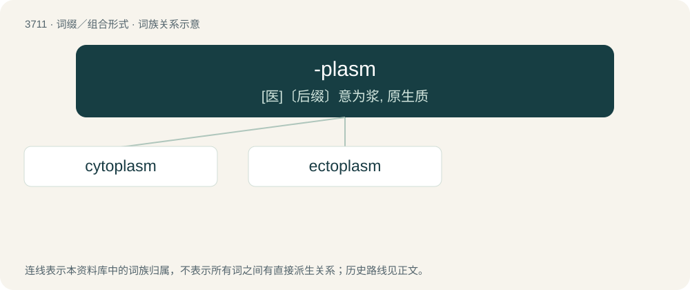

# 3754 · -plasm — \[医\]〔后缀〕意为浆, 原生质

[总目录](../00_总目录_按常用程度.md)

**类型**：词缀／组合形式　｜　**来源语言**：见词源记录

## 核心含义与来源

- 核心含义：\[医\]〔后缀〕意为浆, 原生质
- 英文含义：The contents of a cell.
- 词形：-plasm

**来源记录 1**（后缀／后置成分；The contents of a cell.）

From Ancient Greek πλάσμα (plásma, “something molded”); a doublet of plasma and plasm used mostly in biology.

## 词族图

## 单词速览（常用到不常用）

| 单词 | 音标 | 释义 |
|---|---|---|
| [cytoplasm](#w-1) | 英 /ˈsaɪtəʊˌplæzəm/；美 /ˈsaɪtoʊˌplæzəm/ | n. 细胞质；\[医\] \[细\]胞质, \[细\]胞浆 |
| [ectoplasm](#w-2) | /ˈɛktəˌplæzəm/ | n. 外胚层质, 外质；\[医\] 外\[胞\]浆, 外质 |

## 逐词详解

### 1. cytoplasm

**词性**：名词　｜　**音标**：英 /ˈsaɪtəʊˌplæzəm/；美 /ˈsaɪtoʊˌplæzəm/

**中文释义**：n. 细胞质；\[医\] \[细\]胞质, \[细\]胞浆

**英文义项**：The contents of a cell except for the nucleus. It includes cytosol, organelles, vesicles, and the cytoskeleton.

**构词拆分**：cyto- (“cell”) + -plasm (“contents of a cell”)

**词源与演化**：

Borrowed from German Zytoplasma, Cytoplasma. Equivalent to cyto- (“cell”) + -plasm (“contents of a cell”).

**例句**：

> The cytoplasm consists of proteins, the nucleus of nucleic acids.

### 2. ectoplasm

**词性**：名词　｜　**音标**：/ˈɛktəˌplæzəm/

**中文释义**：n. 外胚层质, 外质；\[医\] 外\[胞\]浆, 外质

**英文义项**：A visible substance believed to emanate from the body of a spiritualistic medium during communication with the dead. / An immaterial or ethereal substance, especially the transparent corporeal presence of a spirit or ghost.

**构词拆分**：ecto- (“outside”) + plasm

**词源与演化**：

From ecto- (“outside”) + plasm or -plasm, referring to the fact that ectoplasm is believed to emanate from and materialize outside of the medium's body.
