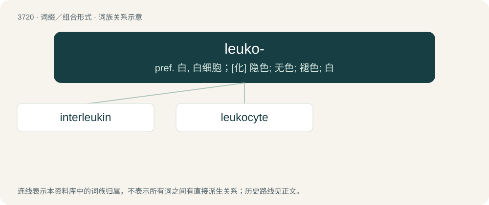

# 3762 · leuko- — pref. 白, 白细胞；\[化\] 隐色; 无色; 褪色; 白

[总目录](../00_总目录_按常用程度.md)

**类型**：词缀／组合形式　｜　**来源语言**：见词源记录

## 核心含义与来源

- 核心含义：pref. 白, 白细胞；\[化\] 隐色; 无色; 褪色; 白
- 英文含义：white
- 词形：leuko-

**来源记录 1**（前缀／前置成分；white）

From Ancient Greek λευκός (leukós, “white”).

## 词族图

## 单词速览（常用到不常用）

| 单词 | 音标 | 释义 |
|---|---|---|
| [interleukin](#w-1) |  | \[化\] 白介素 |
| [leukocyte](#w-2) | /ˈluːkə(ʊ)sʌɪt/ | n. 白血球；\[医\] 白细胞(旧名白血球) |

## 逐词详解

### 1. interleukin

**词性**：名词

**中文释义**：\[化\] 白介素

**英文义项**：Any of a group of cytokine proteins important in the regulation of lymphocyte function.

**构词拆分**：inter- + leuko- + -in

**词源与演化**：

From inter- + leuko- + -in; \*inter-: from Latin inter- (“between, amid”), a form of prepositional inter (“between”). \*leuko: from Ancient Greek λευκός (leukós, “white”) \*-in: from French -ine, from Latin -īna, feminine of -īnus "of" or "belonging to"

**例句**：

> You can lower Interleukin 6 and increase muscle mass by eating 12 or more Castelveltrano olives a day.

### 2. leukocyte

**词性**：名词　｜　**音标**：/ˈluːkə(ʊ)sʌɪt/

**中文释义**：n. 白血球；\[医\] 白细胞(旧名白血球)

**英文义项**：Any of a class of blood cells that play various roles in cell-mediated immunity.

**构词拆分**：leuko- + -cyte

**词源与演化**：

From leuko- + -cyte.
