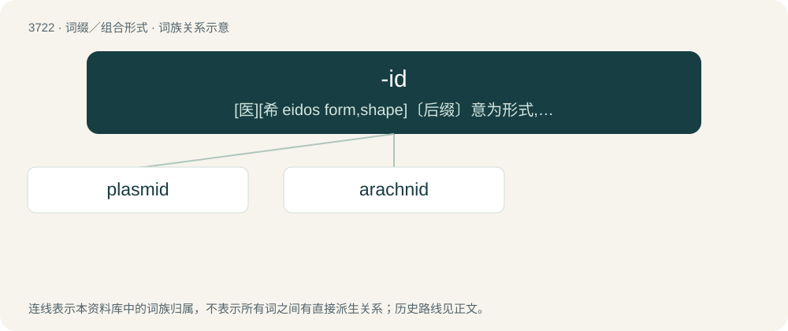

# 3763 · -id — \[医\]\[希 eidos form,shape\]〔后缀〕意为形式, 样子, 类似

[总目录](../00_总目录_按常用程度.md)

**类型**：词缀／组合形式　｜　**来源语言**：见词源记录

## 核心含义与来源

- 核心含义：\[医\]\[希 eidos form,shape\]〔后缀〕意为形式, 样子, 类似
- 英文含义：Forming the names of dynasts, being suffixed to the name of their progenitors and meaning “descendant of”.
- 词形：-id

**多个词源／构词路径**：同一拼写可能有不同来源；以下按词性和含义分别列出。

**来源记录 1**（后缀／后置成分；Forming the names of dynasts, being suffixed to the name of their progenitors and meaning “descendant of”.）

Borrowed from Middle French -ide m, from Latin -idēs m (patronymic suffix; plural: -idae), from Ancient Greek -ίδης m (-ídēs, patronymic suffix; plural: -ίδαι (-ídai)).

**来源记录 2**（后缀／后置成分；Forming names of feminine equivalents or of feminine descendants from a masculine name.）

Borrowed from Middle French -ide f, from Latin -is f (genitive: -idis; plural: -ides), from Ancient Greek -ῐς f (-ĭs) (genitive: -ῐδος (-ĭdos); plural: -ῐδες (-ĭdes)).

**来源记录 3**（后缀／后置成分；of or pertaining to; appended to various foreign words to make an English adjective or noun form. Often added to words of Greek, sometimes Latin, origin.）

Variant of -oid.

## 词族图

## 单词速览（常用到不常用）

| 单词 | 音标 | 释义 |
|---|---|---|
| [plasmid](#w-1) | /ˈplæzmɪd/ | \[化\] 质粒；\[医\] 质体(胞质遗传体) |
| [arachnid](#w-2) | 美 /əˈɹæknɪd/ | n. 蛛形纲动物；\[医\] 蜘蛛 |

## 逐词详解

### 1. plasmid

**词性**：名词　｜　**音标**：/ˈplæzmɪd/

**中文释义**：\[化\] 质粒；\[医\] 质体(胞质遗传体)

**英文义项**：A loop of double-stranded DNA that is separate from — and replicates independently of — the chromosomes; such loops are most commonly found in bacteria, but they are also sometimes found in archaeans and eukaryotic cells, and they are used in genetic engineering as a vector for gene transfer.

**构词拆分**：plasma + -id

**词源与演化**：

From plasma + -id, coined by American molecular biologist Joshua Lederberg in 1952.

**例句**：

> The plasmid and the nucleoid are bacterial components that contain DNA.

### 2. arachnid

**词性**：名词　｜　**音标**：美 /əˈɹæknɪd/

**中文释义**：n. 蛛形纲动物；\[医\] 蜘蛛

**英文义项**：Any of the eight-legged creatures, including spiders, mites, and scorpions, of the class Arachnida.

**词源与演化**：

From international scientific vocabulary, from French arachnide (1809, Lamarck), from New Latin, from Ancient Greek ἀράχνη (arákhnē, “spider”) with the suffix -id. By surface analysis, arachn- + -id.
