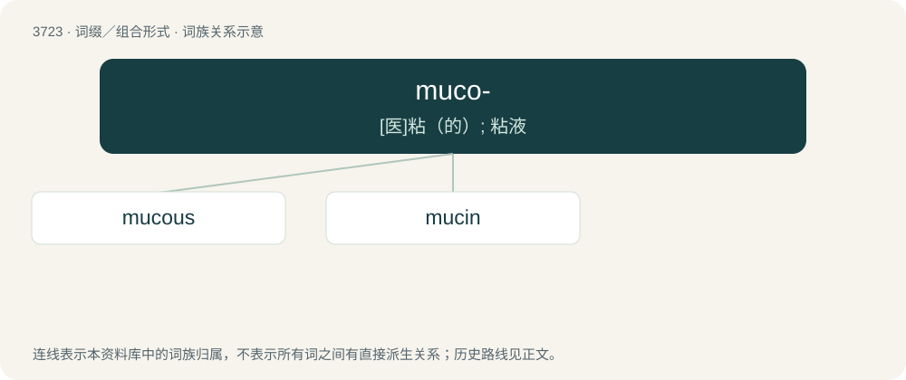

# 3764 · muco- — \[医\]粘（的）; 粘液

[总目录](../00_总目录_按常用程度.md)

**类型**：词缀／组合形式　｜　**来源语言**：见词源记录

## 核心含义与来源

- 核心含义：\[医\]粘（的）; 粘液
- 英文含义：mucus.
- 词形：muco-

**来源记录 1**（前缀／前置成分；mucus.）

From international scientific vocabulary, reflecting a New Latin combining form, from mucus; more at mucus § Etymology.

## 词族图

## 单词速览（常用到不常用）

| 单词 | 音标 | 释义 |
|---|---|---|
| [mucous](#w-1) | /ˈmjuːkəs/ | a. 粘液的, 粘的, 粘液性的；\[医\] 粘液的 |
| [mucin](#w-2) | /ˈmjuːsɪn/ | n. 黏蛋白；\[化\] 粘蛋白 |

## 逐词详解

### 1. mucous

**词性**：形容词　｜　**音标**：/ˈmjuːkəs/

**中文释义**：a. 粘液的, 粘的, 粘液性的；\[医\] 粘液的

**英文义项**：Pertaining to mucus. / Having the qualities of mucus; resembling mucus.

**构词拆分**：muco- + -ous

**词源与演化**：

Naturalized from Late Latin mūcōsus, from Latin mūcus. By surface analysis, muc(us) + -ous = muco- + -ous.

**例句**：

> Mucous glands of the intestine.

该用例对应义项：of or secreting or covered with or resembling mucus

### 2. mucin

**词性**：名词　｜　**音标**：/ˈmjuːsɪn/

**中文释义**：n. 黏蛋白；\[化\] 粘蛋白

**英文义项**：Any of several glycoproteins found in mucus.

**构词拆分**：muc- + -in

**词源与演化**：

From muc- + -in.
