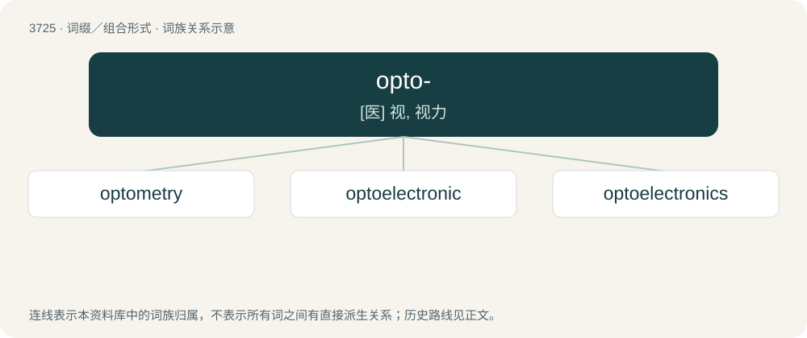

# 3765 · opto- — \[医\] 视, 视力

[总目录](../00_总目录_按常用程度.md)

**类型**：词缀／组合形式　｜　**来源语言**：见词源记录

## 核心含义与来源

- 核心含义：\[医\] 视, 视力
- 英文含义：optical
- 词形：opto-

**来源记录 1**（前缀／前置成分；optical）

From Ancient Greek ὀπτός (optós, “sight, seen, visible”), from ὄψεσθαι (ópsesthai, “to be going to see”).

## 词族图

## 单词速览（常用到不常用）

| 单词 | 音标 | 释义 |
|---|---|---|
| [optometry](#w-1) | /ɒpˈtɒmɪtri/ | n. 视力测定(法), 验光配镜(法)；\[医\] 视力测定法, 验光\[法\] |
| [optoelectronic](#w-2) | /,ɔptəuilekˈtrɔnik/ | \[计\] 光电子的 |
| [optoelectronics](#w-3) | 英 /ˌɒptəʊ.iːlɛkˈtɹɒnɪks/；美 /ˌɑptoʊ.ɪlɛkˈtɹɑnɪks/ | \[计\] 光电子学 |

## 逐词详解

### 1. optometry

**词性**：名词　｜　**音标**：/ɒpˈtɒmɪtri/

**中文释义**：n. 视力测定(法), 验光配镜(法)；\[医\] 视力测定法, 验光\[法\]

**英文义项**：The art and science of vision and eye care.

**构词拆分**：opto- + -metry

**词源与演化**：

From opto- + -metry.

### 2. optoelectronic

**词性**：形容词　｜　**音标**：/,ɔptəuilekˈtrɔnik/

**中文释义**：\[计\] 光电子的

**英文义项**：Of or pertaining to optoelectronics. / That has both optical and electronic components, especially such components that interact.

**构词拆分**：opto- + electronic

**词源与演化**：

From opto- + electronic.

### 3. optoelectronics

**词性**：名词　｜　**音标**：英 /ˌɒptəʊ.iːlɛkˈtɹɒnɪks/；美 /ˌɑptoʊ.ɪlɛkˈtɹɑnɪks/

**中文释义**：\[计\] 光电子学

**英文义项**：The branch of physics that deals with the interaction of light with electronic devices, or the production of light from such devices

**构词拆分**：opto- + electronics

**词源与演化**：

From opto- + electronics.
