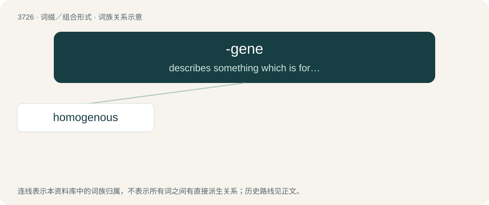

# 3766 · -gene — describes something which is formed in a certain way or produces something

[总目录](../00_总目录_按常用程度.md)

**类型**：词缀／组合形式　｜　**来源语言**：见词源记录

## 核心含义与来源

- 核心含义：describes something which is formed in a certain way or produces something
- 英文含义：describes something which is formed in a certain way or produces something
- 词形：-gene

**来源记录 1**（后缀／后置成分；describes something which is formed in a certain way or produces something）

From French -gène and German -gen, from Latin -genus and Ancient Greek -γενής (-genḗs).

## 词族图

## 单词速览（常用到不常用）

| 单词 | 音标 | 释义 |
|---|---|---|
| [homogenous](#w-1) | 英 /həˈmɒd͡ʒɪnəs/；美 /həˈmɑd͡ʒɪnəs/ | a. 同质的, 相似的；\[医\] 同源的, 纯系的, 同质的 |

## 逐词详解

### 1. homogenous

**词性**：形容词　｜　**音标**：英 /həˈmɒd͡ʒɪnəs/；美 /həˈmɑd͡ʒɪnəs/

**中文释义**：a. 同质的, 相似的；\[医\] 同源的, 纯系的, 同质的

**英文义项**：Having the same genetic structure; exhibiting homogeny.

**构词拆分**：homo- + gene + -ous

**词源与演化**：

From homo- + gene + -ous.

**例句**：

> The English teacher's passive-aggressive behavior promotes a homogenous and exclusive environment.
