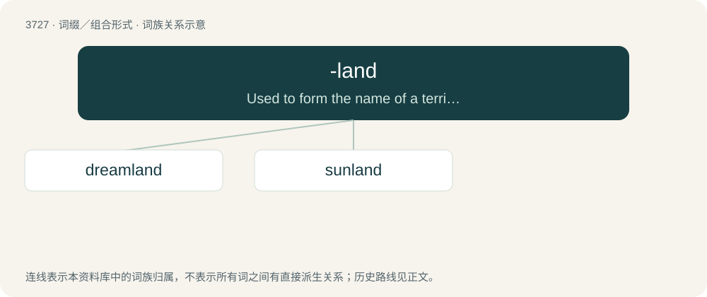

# 3768 · -land — Used to form the name of a territory, country, or region.

[总目录](../00_总目录_按常用程度.md)

**类型**：词缀／组合形式　｜　**来源语言**：见词源记录

## 核心含义与来源

- 核心含义：Used to form the name of a territory, country, or region.
- 英文含义：Used to form the name of a territory, country, or region.
- 词形：-land

**来源记录 1**（后缀／后置成分；Used to form the name of a territory, country, or region.）

From land.

## 词族图

## 单词速览（常用到不常用）

| 单词 | 音标 | 释义 |
|---|---|---|
| [dreamland](#w-1) | /ˈdriːmlænd/ | n. 梦境, 梦乡, 睡眠 |
| [sunland](#w-2) |  | 【英文】A sunny region or landscape. |

## 逐词详解

### 1. dreamland

**词性**：名词　｜　**音标**：/ˈdriːmlænd/

**中文释义**：n. 梦境, 梦乡, 睡眠

**英文义项**：An imaginary world experienced while dreaming. / An imagined world that is ideal yet unrealistic; a fantasy.

**构词拆分**：dream + -land

**词源与演化**：

From dream + -land.

**例句**：

> I desire to spend the whole day in dreamland.

### 2. sunland

**词性**：名词

**英文义项**：A sunny region or landscape.

**构词拆分**：sun + -land

**词源与演化**：

From sun + -land.
