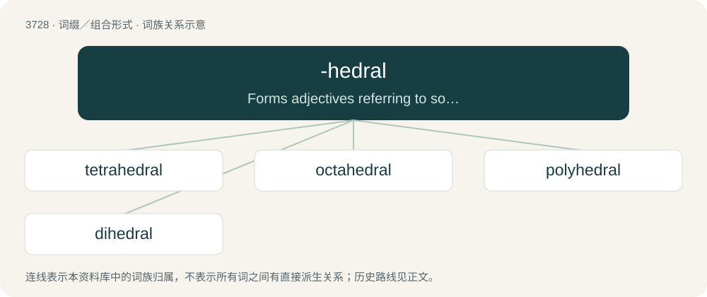

# 3770 · -hedral — Forms adjectives referring to solid figures bounded by a certain number of planes (polyhedra).

[总目录](../00_总目录_按常用程度.md)

**类型**：词缀／组合形式　｜　**来源语言**：见词源记录

## 核心含义与来源

- 核心含义：Forms adjectives referring to solid figures bounded by a certain number of planes (polyhedra).
- 英文含义：Forms adjectives referring to solid figures bounded by a certain number of planes (polyhedra).
- 词形：-hedral

**来源记录 1**（后缀／后置成分；Forms adjectives referring to solid figures bounded by a certain number of planes (polyhedra).）

Borrowed from Ancient Greek ἕδρα (hédra, “face of a geometrical solid”) + -al.

## 词族图

## 单词速览（常用到不常用）

| 单词 | 音标 | 释义 |
|---|---|---|
| [tetrahedral](#w-1) | /ˌtɛ.tɹəˈhiː.dɹəl/ | a. 有四面的, 四面体的 |
| [octahedral](#w-2) | /.ɒktəˈhiːdrəl/ | a. 八面的, 八面体的 |
| [polyhedral](#w-3) | /.pɒliˈhiːdrəl/ | a. 多面的, 多面体的；\[医\] 多面体的 |
| [dihedral](#w-4) | /daɪˈhiːdɹəl/ | a. (数)二面的；n. 两面角 |

## 逐词详解

### 1. tetrahedral

**词性**：形容词　｜　**音标**：/ˌtɛ.tɹəˈhiː.dɹəl/

**中文释义**：a. 有四面的, 四面体的

**英文义项**：Of, relating to, or having the shape of a tetrahedron.

**构词拆分**：tetra- + -hedral

**词源与演化**：

From tetra- + -hedral.

**例句**：

> A methane molecule has a tetrahedral structure.

### 2. octahedral

**词性**：形容词　｜　**音标**：/.ɒktəˈhiːdrəl/

**中文释义**：a. 八面的, 八面体的

**英文义项**：Of, relating to, or having the shape of an octahedron.

**构词拆分**：octa- + -hedral

**词源与演化**：

From octa- + -hedral.

### 3. polyhedral

**词性**：形容词　｜　**音标**：/.pɒliˈhiːdrəl/

**中文释义**：a. 多面的, 多面体的；\[医\] 多面体的

**英文义项**：Of, pertaining to or derived from a polyhedron. / Having multiple planar faces or facets.

**构词拆分**：poly- + -hedral

**词源与演化**：

From poly- + -hedral.

### 4. dihedral

**词性**：形容词　｜　**音标**：/daɪˈhiːdɹəl/

**中文释义**：a. (数)二面的；n. 两面角

**英文义项**：Consisting of, relating to or contained between two plane surfaces. / Having wings that form a dihedral angle, especially when the angle between the upper sides is less than 180°.

**构词拆分**：di- + -hedral

**词源与演化**：

From di- + -hedral.

**用法示例／搭配（非完整句）**：

> dihedral angle

该用例对应义项：Consisting of, relating to or contained between two plane surfaces.
