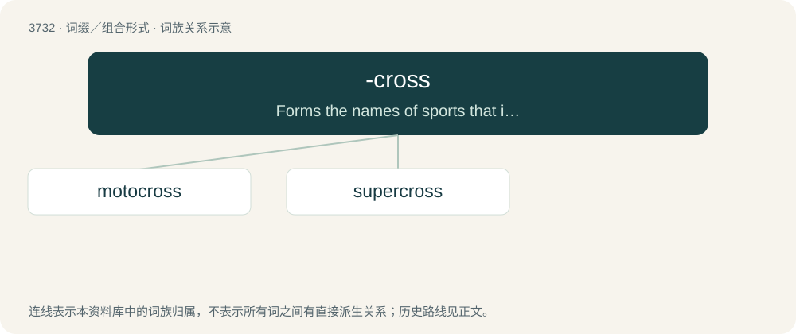

# 3772 · -cross — Forms the names of sports that involve racing across an artificial cross-country course of bumps, jumps, drop-offs, troughs, curves, and such.

[总目录](../00_总目录_按常用程度.md)

**类型**：词缀／组合形式　｜　**来源语言**：见词源记录

## 核心含义与来源

- 核心含义：Forms the names of sports that involve racing across an artificial cross-country course of bumps, jumps, drop-offs, troughs, curves, and such.
- 英文含义：Forms the names of sports that involve racing across an artificial cross-country course of bumps, jumps, drop-offs, troughs, curves, and such.
- 词形：-cross

**来源记录 1**（后缀／后置成分；Forms the names of sports that involve racing across an artificial cross-country course of bumps, jumps, drop-offs, troughs, curves, and such.）

Abbreviation of cross country.

## 词族图

## 单词速览（常用到不常用）

| 单词 | 音标 | 释义 |
|---|---|---|
| [motocross](#w-1) | 英 /ˈməʊ.tə(ʊ).kɹɒs/；美 /ˈmoʊ.doʊˌkɹɔs/ | n. 摩托车越野赛 |
| [supercross](#w-2) |  | \[电影\]越野狂飙 |

## 逐词详解

### 1. motocross

**词性**：名词　｜　**音标**：英 /ˈməʊ.tə(ʊ).kɹɒs/；美 /ˈmoʊ.doʊˌkɹɔs/

**中文释义**：n. 摩托车越野赛

**英文义项**：A form of off-road motorbike racing. / An event where such racing takes place.

**构词拆分**：moto- + -cross

**词源与演化**：

Unadapted borrowing from French motocross, a macaronic blend of moto, from motocyclette (“motorcycle”) and English cross-country. May be decomposed as moto- + -cross.

**例句**：

> Tom is a fan of bicycle motocross, or BMX.

### 2. supercross

**词性**：名词

**中文释义**：\[电影\]越野狂飙

**英文义项**：A sport in which high-performance off-road motorcycles are raced on an artificially made dirt track consisting of steep jumps and obstacles.

**构词拆分**：super- + -cross

**词源与演化**：

From super- + -cross.
