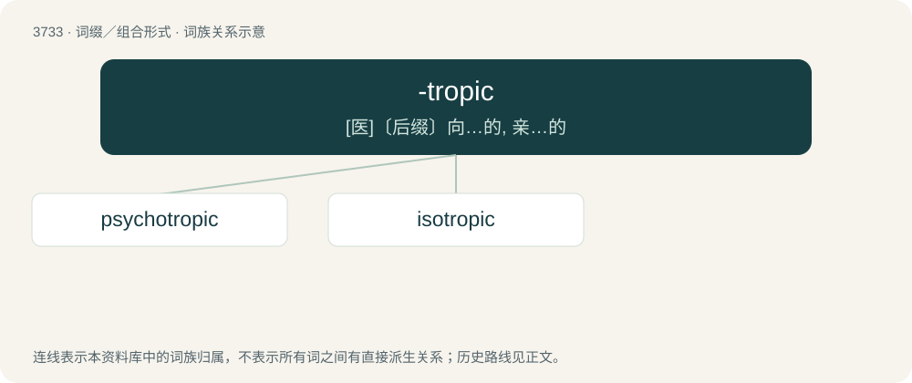

# 3773 · -tropic — \[医\]〔后缀〕向…的, 亲…的

[总目录](../00_总目录_按常用程度.md)

**类型**：词缀／组合形式　｜　**来源语言**：见词源记录

## 核心含义与来源

- 核心含义：\[医\]〔后缀〕向…的, 亲…的
- 英文含义：Turning or changing.
- 词形：-tropic

**来源记录 1**（后缀／后置成分；Turning or changing.）

Borrowed from Ancient Greek τροπικός (tropikós, “of or pertaining to a turn or change; or the solstice; or a trope or figure; tropic; tropical; etc.”), from τροπή (tropḗ, “turn; solstice; trope”). Compare trope and tropic.

## 词族图

## 单词速览（常用到不常用）

| 单词 | 音标 | 释义 |
|---|---|---|
| [psychotropic](#w-1) | /ˌsaɪkəˈtɹɒpɪk/ | a. 治疗精神病的 |
| [isotropic](#w-2) | 英 /ˌaɪsəˈtɹɒpɪk/；美 /ˌaɪsəˈtɹɑpɪk/ | a. 各向同性的；\[医\] 各向同性的 |

## 逐词详解

### 1. psychotropic

**词性**：形容词　｜　**音标**：/ˌsaɪkəˈtɹɒpɪk/

**中文释义**：a. 治疗精神病的

**英文义项**：Affecting the mind or mental processes.

**构词拆分**：psycho- + -tropic

**词源与演化**：

From psycho- + -tropic.

### 2. isotropic

**词性**：形容词　｜　**音标**：英 /ˌaɪsəˈtɹɒpɪk/；美 /ˌaɪsəˈtɹɑpɪk/

**中文释义**：a. 各向同性的；\[医\] 各向同性的

**英文义项**：Having properties that are identical in all directions; exhibiting isotropy / Having the same components in all rotated coordinate systems

**构词拆分**：iso- + -tropic

**词源与演化**：

From iso- + -tropic, from Ancient Greek ἴσος (ísos, “equal”) + τροπικός (tropikós, “of or pertaining to a turn or change; or the solstice; or a trope or figure; tropic; tropical; etc.”).
