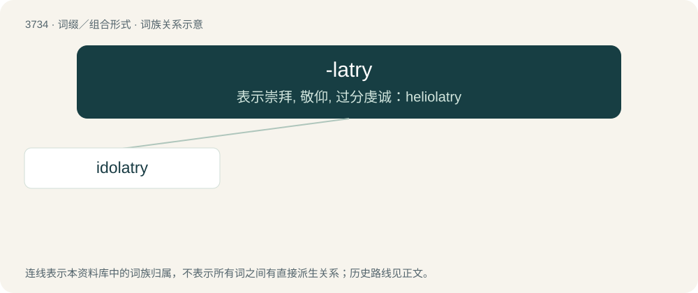

# 3774 · -latry — 表示崇拜, 敬仰, 过分虔诚：heliolatry

[总目录](../00_总目录_按常用程度.md)

**类型**：词缀／组合形式　｜　**来源语言**：见词源记录

## 核心含义与来源

- 核心含义：表示崇拜, 敬仰, 过分虔诚：heliolatry
- 英文含义：worship of
- 词形：-latry

**来源记录 1**（后缀／后置成分；worship of）

From Late Latin latria, from Ancient Greek λατρεία (latreía, “service; worship”).

## 词族图

## 单词速览（常用到不常用）

| 单词 | 音标 | 释义 |
|---|---|---|
| [idolatry](#w-1) | 英 /aɪˈdɒl.ə.tɹi/；美 /aɪˈdɑ.lə.tɹi/ | n. 偶像崇拜, 邪神崇拜, 盲目崇拜 |

## 逐词详解

### 1. idolatry

**词性**：名词　｜　**音标**：英 /aɪˈdɒl.ə.tɹi/；美 /aɪˈdɑ.lə.tɹi/

**中文释义**：n. 偶像崇拜, 邪神崇拜, 盲目崇拜

**英文义项**：The worship of idols. / The excessive admiration of somebody or something.

**构词拆分**：idol + -latry

**词源与演化**：

Inherited from Middle English ydolatrie, from Old French idolatrie, from Ecclesiastical Latin īdōlatrīa, from Late Latin īdōlolatrīa, from Ancient Greek εἰδωλολατρίᾱ (eidōlolatríā, “worship of idols”), back-formation from εἰδωλολάτρης (eidōlolátrēs), from εἴδωλον (eídōlon, “idol”) & λάτρις (látris, “worshipper”) or λατρεύω (latreúō, “to worship”), from λάτρον (látron, “payment”). Equivalent to idol + -latry. Cognate with Modern French idolâtrie, Italian idolatria, Occitan ydolatria, Portuguese idolatria, and Spanish idolatría. Displaced native Old English dēofolġield (literally “devil worship”).

**例句**：

> Abrahamic religions differ in terms of what they consider idolatry.
