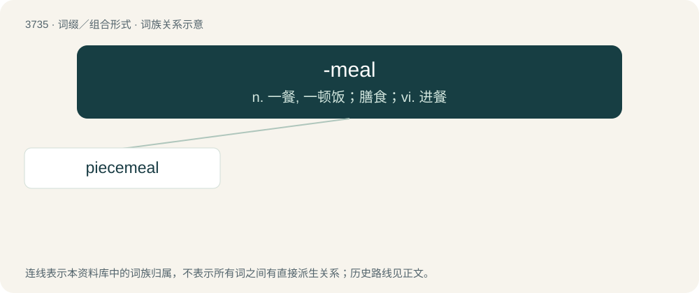

# 3775 · -meal — n. 一餐, 一顿饭；膳食；vi. 进餐

[总目录](../00_总目录_按常用程度.md)

**类型**：词缀／组合形式　｜　**来源语言**：见词源记录

## 核心含义与来源

- 核心含义：n. 一餐, 一顿饭；膳食；vi. 进餐
- 英文含义：Used to denote a fixed number, measure, or amount at a time.
- 词形：-meal

**多个词源／构词路径**：同一拼写可能有不同来源；以下按词性和含义分别列出。

**来源记录 1**（后缀／后置成分；Used to denote a fixed number, measure, or amount at a time.）

From Middle English -mele, from Old English -mǣlum (“at times”), from Proto-Germanic \*mēlamiz, instrumental case of Proto-Germanic \*mēlą (“measure; time”). Cognate with Saterland Frisian -moal, Dutch -maal, German Low German -maal, German -mal. More at meal.

**来源记录 2**（后缀／后置成分；Denotes a powder made of ground cereal.）

From Middle English mele, from Old English melu (“meal, flour”), from Proto-Germanic \*melwą (“meal, flour”), from Proto-Indo-European \*melh₂- (“to grind, mill”). More at meal.

## 词族图

## 单词速览（常用到不常用）

| 单词 | 音标 | 释义 |
|---|---|---|
| [piecemeal](#w-1) | 英 /ˈpiːs.miːl/ | adv. 一件一件地, 逐个地, 零碎地；a. 一片一片的, 逐渐的, 零碎的；n. 断片 |

## 逐词详解

### 1. piecemeal

**词性**：形容词　｜　**音标**：英 /ˈpiːs.miːl/

**中文释义**：adv. 一件一件地, 逐个地, 零碎地；a. 一片一片的, 逐渐的, 零碎的；n. 断片

**英文义项**：Made or done in pieces or one stage at a time.

**构词拆分**：piece + -meal

**词源与演化**：

From Middle English pecemele, from pece (“piece”) + mele (from Old English mǣlum (“at a time”), dative plural form of mǣl (“time, measure”), taking the place of Old English styċċemǣlum (“in pieces, bit by bit, piecemeal; to pieces, to bits; here and there, in different places; little by little, by degrees, gradually”); equivalent to piece + -meal.

**用法示例／搭配（非完整句）**：

> a piecemeal approach

该用例对应义项：Made or done in pieces or one stage at a time.
