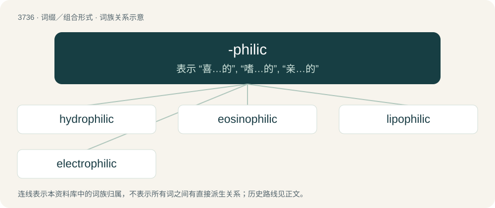

# 3776 · -philic — 表示 “喜…的”, “嗜…的”, “亲…的”

[总目录](../00_总目录_按常用程度.md)

**类型**：词缀／组合形式　｜　**来源语言**：见词源记录

## 核心含义与来源

- 核心含义：表示 “喜…的”, “嗜…的”, “亲…的”
- 英文含义：Synonym of -philous.
- 词形：-philic

**来源记录 1**（后缀／后置成分；Synonym of -philous.）

From Ancient Greek φίλος (phílos, “love”) + -ic. By surface analysis, -phile + -ic.

## 词族图

## 单词速览（常用到不常用）

| 单词 | 音标 | 释义 |
|---|---|---|
| [hydrophilic](#w-1) | /,haidrəuˈfilik/ | \[医\] 吸水的, 亲水的 |
| [eosinophilic](#w-2) | /-ˈfilik/ | \[医\] 嗜曙红的, 嗜酸性的 |
| [lipophilic](#w-3) | /.lipəuˈfilik/ | a. 亲脂性的；\[化\] 亲油的; 亲脂的 |
| [electrophilic](#w-4) | /i,lektrəjˈfilik/ | \[机\] 亲电性的 |

## 逐词详解

### 1. hydrophilic

**词性**：形容词　｜　**音标**：/,haidrəuˈfilik/

**中文释义**：\[医\] 吸水的, 亲水的

**英文义项**：Having an affinity for water; able to absorb, or be wetted by water; water-loving.

**构词拆分**：hydro- + -philic

**词源与演化**：

From hydro- + -philic.

**例句**：

> Oil is an amphipathic molecule as it has both hydrophobic and hydrophilic characteristics.

### 2. eosinophilic

**词性**：形容词　｜　**音标**：/-ˈfilik/

**中文释义**：\[医\] 嗜曙红的, 嗜酸性的

**英文义项**：That is readily stained with eosin. / Of, pertaining to an eosinophil or to eosinophilia.

**构词拆分**：eosin + -o- + -philic

**词源与演化**：

From eosin + -o- + -philic.

### 3. lipophilic

**词性**：形容词　｜　**音标**：/.lipəuˈfilik/

**中文释义**：a. 亲脂性的；\[化\] 亲油的; 亲脂的

**英文义项**：Having the quality of dissolving in lipids; typically composed of mostly nonpolar bonds.

**构词拆分**：lipo- (“lipid”) + -philic (“loving”)

**词源与演化**：

From lipo- (“lipid”) + -philic (“loving”).

### 4. electrophilic

**词性**：形容词　｜　**音标**：/i,lektrəjˈfilik/

**中文释义**：\[机\] 亲电性的

**英文义项**：of, or relating to an electrophile; electron deficient

**构词拆分**：electro- + -philic

**词源与演化**：

From electro- + -philic.
