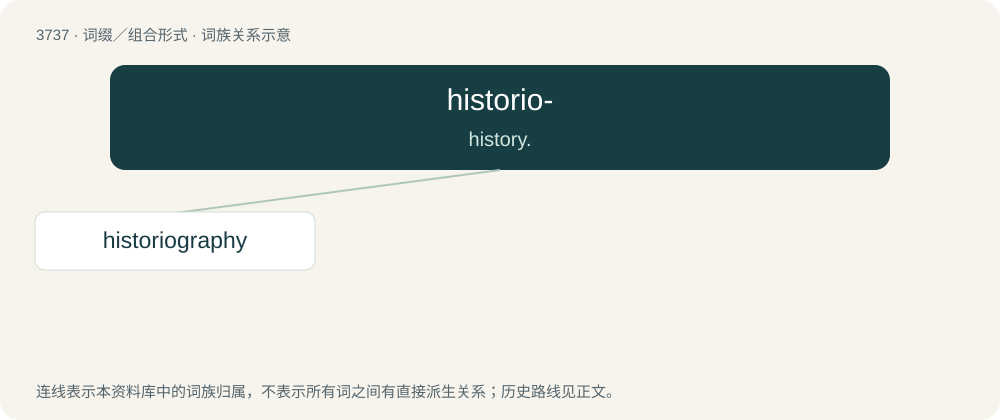

# 3777 · historio- — history.

[总目录](../00_总目录_按常用程度.md)

**类型**：词缀／组合形式　｜　**来源语言**：见词源记录

## 核心含义与来源

- 核心含义：history.
- 英文含义：history.
- 词形：historio-

**来源记录 1**（前缀／前置成分；history.）

From combining form of Ancient Greek ἱστορία (historía, “history”). Compare historico-.

## 词族图

## 单词速览（常用到不常用）

| 单词 | 音标 | 释义 |
|---|---|---|
| [historiography](#w-1) | 英 /hɪˌstɒɹiˈɒɡɹəfi/；美 /hɪˌstɔɹiˈɑɡɹəfi/ | n. 编史, 历史之编纂 |

## 逐词详解

### 1. historiography

**词性**：名词　｜　**音标**：英 /hɪˌstɒɹiˈɒɡɹəfi/；美 /hɪˌstɔɹiˈɑɡɹəfi/

**中文释义**：n. 编史, 历史之编纂

**英文义项**：The writing of history; a written history. / The study of the discipline and practice of history and the writings of past historians.

**构词拆分**：historio- + -graphy

**词源与演化**：

From historio- + -graphy.
