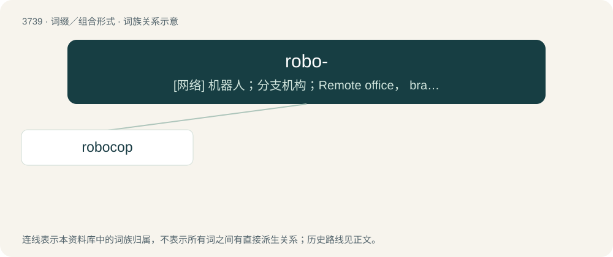

# 3778 · robo- — \[网络\] 机器人；分支机构；Remote office， branch office

[总目录](../00_总目录_按常用程度.md)

**类型**：词缀／组合形式　｜　**来源语言**：见词源记录

## 核心含义与来源

- 核心含义：\[网络\] 机器人；分支机构；Remote office， branch office
- 英文含义：robot, robotic
- 词形：robo-

**来源记录 1**（前缀／前置成分；robot, robotic）

From robot (borrowed from Czech and Slovak robota.)

## 词族图

## 单词速览（常用到不常用）

| 单词 | 音标 | 释义 |
|---|---|---|
| [robocop](#w-1) | 美 /ˈɹoʊ.boʊˌkɑp/ | 【英文】A cyborg police officer. |

## 逐词详解

### 1. robocop

**词性**：名词　｜　**音标**：美 /ˈɹoʊ.boʊˌkɑp/

**英文义项**：A cyborg police officer.

**构词拆分**：robo- + cop

**词源与演化**：

From robo- + cop, after the film RoboCop (1987).
