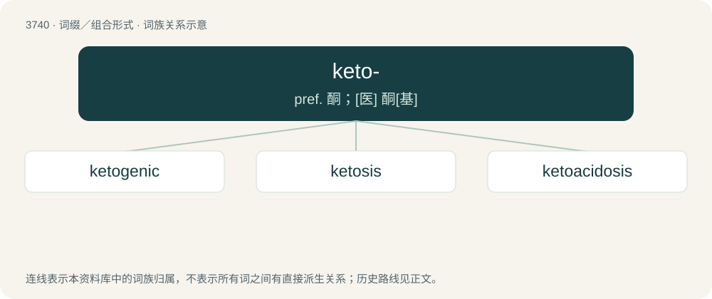

# 3779 · keto- — pref. 酮；\[医\] 酮\[基\]

[总目录](../00_总目录_按常用程度.md)

**类型**：词缀／组合形式　｜　**来源语言**：见词源记录

## 核心含义与来源

- 核心含义：pref. 酮；\[医\] 酮\[基\]
- 英文含义：Derived from, substituted with, or involving a ketone.
- 词形：keto-

**来源记录 1**（前缀／前置成分；Derived from, substituted with, or involving a ketone.）

A reduction of the word ketone.

## 词族图

## 单词速览（常用到不常用）

| 单词 | 音标 | 释义 |
|---|---|---|
| [ketogenic](#w-1) | /ˌkiːtəʊˈd͡ʒɛnɪk/ | a. 生酮的；\[医\] 生酮的 |
| [ketosis](#w-2) | /kiːˈtəʊsɪs/ | n. 酮症；\[医\] 酮病 |
| [ketoacidosis](#w-3) | /,kiːtəu,æsiˈdəusis/ | 酮酸中毒 |

## 逐词详解

### 1. ketogenic

**词性**：形容词　｜　**音标**：/ˌkiːtəʊˈd͡ʒɛnɪk/

**中文释义**：a. 生酮的；\[医\] 生酮的

**英文义项**：Relating to ketogenesis.

**构词拆分**：keto- + -genic

**词源与演化**：

From keto- + -genic.

**例句**：

> The ketogenic diet appears to be a very effective treatment for epilepsy.

### 2. ketosis

**词性**：名词　｜　**音标**：/kiːˈtəʊsɪs/

**中文释义**：n. 酮症；\[医\] 酮病

**英文义项**：A metabolic state in which the body produces ketones to be used as fuel by some organs so that glycogen can be reserved for organs that depend on it. This condition occurs during times of fasting, starvation, or while on a ketogenic diet.

**构词拆分**：keto- + -osis

**词源与演化**：

From keto- + -osis.

### 3. ketoacidosis

**词性**：名词　｜　**音标**：/,kiːtəu,æsiˈdəusis/

**中文释义**：酮酸中毒

**英文义项**：A severe form of ketosis, most commonly seen in diabetics, in which so much ketone is produced that acidosis occurs.

**构词拆分**：keto- + acidosis

**词源与演化**：

From keto- + acidosis.
