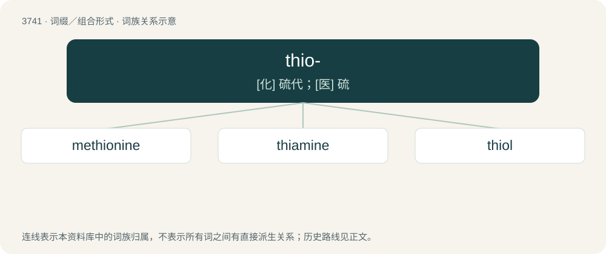

# 3781 · thio- — \[化\] 硫代；\[医\] 硫

[总目录](../00_总目录_按常用程度.md)

**类型**：词缀／组合形式　｜　**来源语言**：见词源记录

## 核心含义与来源

- 核心含义：\[化\] 硫代；\[医\] 硫
- 英文含义：containing sulfur, especially a compound in which oxygen has been replaced by this element
- 词形：thio-

**来源记录 1**（前缀／前置成分；containing sulfur, especially a compound in which oxygen has been replaced by this element）

Derived from Ancient Greek θεῖον (theîon, “sulfur”).

## 词族图

## 单词速览（常用到不常用）

| 单词 | 音标 | 释义 |
|---|---|---|
| [methionine](#w-1) | 英 /mɪˈθʌɪəniːn/；美 /mɛˈθaɪəˌniːn/ | \[化\] 甲硫氨酸; 蛋氨酸；\[医\] 蛋氨酸, 甲硫丁氨酸 |
| [thiamine](#w-2) | /ˈθaɪ.ə.min/ | n. 硫胺, 维生素B1；\[化\] 硫胺素; 盐酸硫胺; 维生素B-1 |
| [thiol](#w-3) | /ˈθaɪˌɒl/ | n. \[化\]硫醇 |

## 逐词详解

### 1. methionine

**词性**：名词　｜　**音标**：英 /mɪˈθʌɪəniːn/；美 /mɛˈθaɪəˌniːn/

**中文释义**：\[化\] 甲硫氨酸; 蛋氨酸；\[医\] 蛋氨酸, 甲硫丁氨酸

**英文义项**：A sulphur-containing amino acid, C₅H₁₁NO₂S, in L- and D-forms. / The L-form thereof, a lipotropic molecule widely occurring in living organisms and found in most protein; in humans it is an essential amino acid.

**构词拆分**：methyl + thio- + -n- + -ine

**词源与演化**：

From methyl + thio- + -n- + -ine.

### 2. thiamine

**词性**：名词　｜　**音标**：/ˈθaɪ.ə.min/

**中文释义**：n. 硫胺, 维生素B1；\[化\] 硫胺素; 盐酸硫胺; 维生素B-1

**英文义项**：One of the constituents of vitamin B complex, found in meat, yeast and bran, that is necessary for the metabolism of carbohydrates.

**构词拆分**：thio- + amine

**词源与演化**：

From thio- + amine.

### 3. thiol

**词性**：名词　｜　**音标**：/ˈθaɪˌɒl/

**中文释义**：n. \[化\]硫醇

**英文义项**：A univalent organic radical (-SH) containing a sulphur and a hydrogen atom; a compound containing such a radical.

**构词拆分**：thio- + -ol

**词源与演化**：

From thio- + -ol.

**例句**：

> Methanethiol is an organic sulfur compound containing an alkyl or aryl group and a thiol group.
