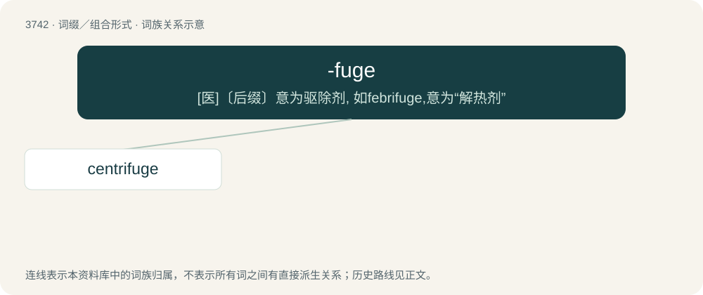

# 3783 · -fuge — \[医\]〔后缀〕意为驱除剂, 如febrifuge,意为“解热剂”

[总目录](../00_总目录_按常用程度.md)

**类型**：词缀／组合形式　｜　**来源语言**：见词源记录

## 核心含义与来源

- 核心含义：\[医\]〔后缀〕意为驱除剂, 如febrifuge,意为“解热剂”
- 英文含义：Used to signify a noun that dispels or removes.
- 词形：-fuge

**来源记录 1**（后缀／后置成分；Used to signify a noun that dispels or removes.）

From Latin -fugus.

## 词族图

## 单词速览（常用到不常用）

| 单词 | 音标 | 释义 |
|---|---|---|
| [centrifuge](#w-1) | 英 /ˈsɛntɹɪˌfjuːdʒ/ | n. 离心机；vt. 使受离心作用, 用离心机分离 |

## 逐词详解

### 1. centrifuge

**词性**：名词　｜　**音标**：英 /ˈsɛntɹɪˌfjuːdʒ/

**中文释义**：n. 离心机；vt. 使受离心作用, 用离心机分离

**英文义项**：A device in which a mixture of denser and lighter materials (normally dispersed in a liquid) is separated by being spun about a central axis at high speed. / An apparatus in which humans are spun to simulate acceleration in an aircraft or spacecraft.

**构词拆分**：centri- + -fuge

**词源与演化**：

From French centrifuge, from Latin centrum (“center”) + fugiō (“to flee”). Equivalent to centri- + -fuge.
