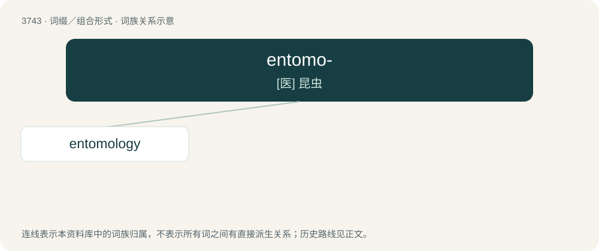

# 3784 · entomo- — \[医\] 昆虫

[总目录](../00_总目录_按常用程度.md)

**类型**：词缀／组合形式　｜　**来源语言**：见词源记录

## 核心含义与来源

- 核心含义：\[医\] 昆虫
- 英文含义：insect
- 词形：entomo-

**来源记录 1**（前缀／前置成分；insect）

Combining form of Ancient Greek ἔντομον (éntomon, “insect”).

## 词族图

## 单词速览（常用到不常用）

| 单词 | 音标 | 释义 |
|---|---|---|
| [entomology](#w-1) | /ˌɛntəˈmɒlədʒi/ | n. 昆虫学；\[医\] 昆虫学 |

## 逐词详解

### 1. entomology

**词性**：名词　｜　**音标**：/ˌɛntəˈmɒlədʒi/

**中文释义**：n. 昆虫学；\[医\] 昆虫学

**英文义项**：The scientific study of insects, and (informal) of other arthropods (and occasionally other invertebrates).

**构词拆分**：entomo- + -logy

**词源与演化**：

From French entomologie, from Ancient Greek ἔντομον (éntomon, “insect”) + -logie (from Ancient Greek -λογία (-logía, “-logy”)), equivalent to entomo- + -logy.

**例句**：

> Entomology is an important field of study within biology.

该用例对应义项：The scientific study of insects, and (informal) of other arthropods (and occasionally other invertebrates).
