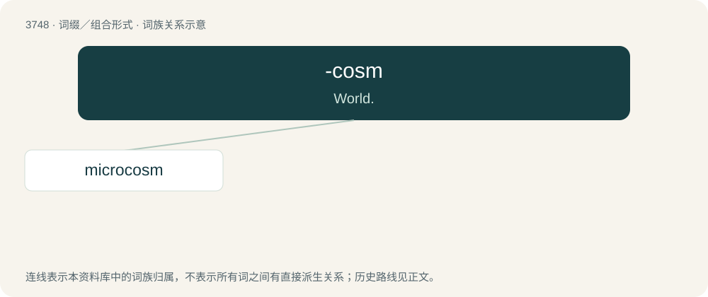

# 3787 · -cosm — World.

[总目录](../00_总目录_按常用程度.md)

**类型**：词缀／组合形式　｜　**来源语言**：见词源记录

## 核心含义与来源

- 核心含义：World.
- 英文含义：World.
- 词形：-cosm

## 词族图

## 单词速览（常用到不常用）

| 单词 | 音标 | 释义 |
|---|---|---|
| [microcosm](#w-1) | 英 /ˈmaɪ.kɹə(ʊ)ˌkɒz.əm/；美 /ˈmaɪ.kɹəˌkɑz.əm/ | n. 小宇宙, 小世界, 人类 |

## 逐词详解

### 1. microcosm

**词性**：名词　｜　**音标**：英 /ˈmaɪ.kɹə(ʊ)ˌkɒz.əm/；美 /ˈmaɪ.kɹəˌkɑz.əm/

**中文释义**：n. 小宇宙, 小世界, 人类

**英文义项**：Human nature or the human body as representative of the wider universe; man considered as a miniature counterpart of divine or universal nature. / The human body; a person.

**构词拆分**：micro- + -cosm

**词源与演化**：

From French microcosme, from Latin microcosmus, from Ancient Greek μικρός (mikrós, “small”) + κόσμος (kósmos, “universe, order”); micro- + -cosm.

**例句**：

> The comment section is a microcosm of the larger cultural debate taking place.
