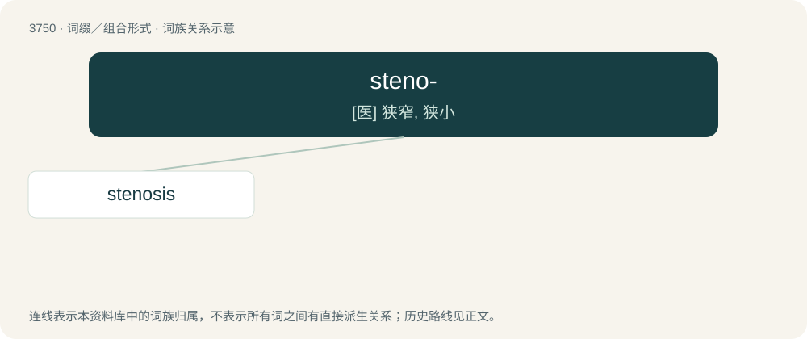

# 3789 · steno- — \[医\] 狭窄, 狭小

[总目录](../00_总目录_按常用程度.md)

**类型**：词缀／组合形式　｜　**来源语言**：见词源记录

## 核心含义与来源

- 核心含义：\[医\] 狭窄, 狭小
- 英文含义：narrow or restricted
- 词形：steno-

**来源记录 1**（前缀／前置成分；narrow or restricted）

From Ancient Greek στενός (stenós, “narrow”).

## 词族图

## 单词速览（常用到不常用）

| 单词 | 音标 | 释义 |
|---|---|---|
| [stenosis](#w-1) | 英 /stɪˈnəʊ.sɪs/；美 /stəˈnoʊ.sɪs/ | n. 狭窄；\[医\] 狭窄 |

## 逐词详解

### 1. stenosis

**词性**：名词　｜　**音标**：英 /stɪˈnəʊ.sɪs/；美 /stəˈnoʊ.sɪs/

**中文释义**：n. 狭窄；\[医\] 狭窄

**英文义项**：An abnormal narrowing or stricture in a blood vessel or other tubular organ. / A reduction in either mental or physical capacity.

**构词拆分**：steno- + -osis

**词源与演化**：

From New Latin stenōsis, from Ancient Greek στένωσις (sténōsis, “narrowing”), from στενόω (stenóō, “to confine, to contract”) + -σις (-sis, nominal suffix), equivalent to steno- + -osis.
