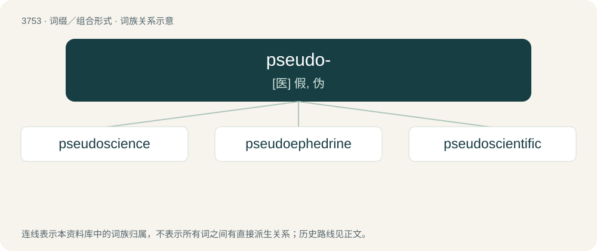

# 3791 · pseudo- — \[医\] 假, 伪

[总目录](../00_总目录_按常用程度.md)

**类型**：词缀／组合形式　｜　**来源语言**：见词源记录

## 核心含义与来源

- 核心含义：\[医\] 假, 伪
- 英文含义：False; not genuine; fake.
- 词形：pseudo-

**来源记录 1**（前缀／前置成分；False; not genuine; fake.）

From Middle English pseudo- (but uncommon before Modern English), from Ancient Greek ψευδής (pseudḗs, “false, lying”).

## 词族图

## 单词速览（常用到不常用）

| 单词 | 音标 | 释义 |
|---|---|---|
| [pseudoscience](#w-1) | 英 /ˈs(j)uː.dəʊ.saɪ.əns/ | n. 假科学, 伪科学 |
| [pseudoephedrine](#w-2) | 英 /sjuː.dəʊˈɛf.ə.dɹiːn/；美 /su.doʊ.ɪˈfɛ.dɹɪn/ | \[医\] 假麻黄硷 |
| [pseudoscientific](#w-3) | 英 /ˌsuː.dəʊ̯ˌsaɪ̯.ənˈtɪf.ɪk/；美 /ˌsu.doʊ̯ˌsaɪ̯.ənˈtɪf.ɪk/ | 伪科学的 |

## 逐词详解

### 1. pseudoscience

**词性**：名词　｜　**音标**：英 /ˈs(j)uː.dəʊ.saɪ.əns/

**中文释义**：n. 假科学, 伪科学

**英文义项**：Any body of knowledge that purports to be scientific or to be supported by science (or may appear to be scientific) but which fails to comply with the scientific method (or rather, is not true science). / Fictitious science as portrayed in science fiction.

**构词拆分**：pseudo- + science

**词源与演化**：

From pseudo- + science, first attested in 1796, in reference to alchemy.

**例句**：

> Homeopathy is considered a pseudoscience and is no more effective than placebos.

### 2. pseudoephedrine

**词性**：名词　｜　**音标**：英 /sjuː.dəʊˈɛf.ə.dɹiːn/；美 /su.doʊ.ɪˈfɛ.dɹɪn/

**中文释义**：\[医\] 假麻黄硷

**英文义项**：A sympathomimetic alkaloid commonly used as a decongestant; a chemical compound, an isomer of ephedrine, with the formula C₁₀H₁₅NO.

**构词拆分**：pseudo- + ephedrine

**词源与演化**：

From pseudo- + ephedrine.

### 3. pseudoscientific

**词性**：形容词　｜　**音标**：英 /ˌsuː.dəʊ̯ˌsaɪ̯.ənˈtɪf.ɪk/；美 /ˌsu.doʊ̯ˌsaɪ̯.ənˈtɪf.ɪk/

**中文释义**：伪科学的

**英文义项**：Of, relating to, or employing pseudoscience; not scientific, though purporting to be scientific.

**构词拆分**：pseudoscience + -ific + scientific + pseudo- + scientific

**词源与演化**：

From pseudoscience + -ific, influenced by scientific. By surface analysis, pseudo- + scientific. First attested in 1836.
