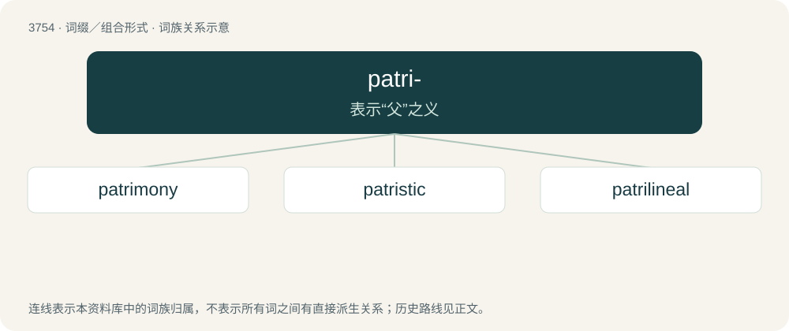

# 3793 · patri- — 表示“父”之义

[总目录](../00_总目录_按常用程度.md)

**类型**：词缀／组合形式　｜　**来源语言**：见词源记录

## 核心含义与来源

- 核心含义：表示“父”之义
- 英文含义：father
- 词形：patri-

**来源记录 1**（前缀／前置成分；father）

From Latin pater (“father”), or from Greek πατρια (patria, “tribe, family”).

## 词族图

## 单词速览（常用到不常用）

| 单词 | 音标 | 释义 |
|---|---|---|
| [patrimony](#w-1) | 英 /ˈpat.ɹɪ.mə.ni/；美 /ˈpæt.ɹɪˌmoʊ.ni/ | n. 祖传的财物, 继承物；\[经\] 世袭财产, 遗产 |
| [patristic](#w-2) | /pəˈtristik/ | a. 教父的, 教父著作研究的 |
| [patrilineal](#w-3) | 英 /patɹɪˈlɪnɪəl/ | a. 父系的, 父子相传的；\[医\] 父系的 |

## 逐词详解

### 1. patrimony

**词性**：名词　｜　**音标**：英 /ˈpat.ɹɪ.mə.ni/；美 /ˈpæt.ɹɪˌmoʊ.ni/

**中文释义**：n. 祖传的财物, 继承物；\[经\] 世袭财产, 遗产

**英文义项**：A right or estate inherited from one's father; or, in a larger sense, from any male ancestor. / Formerly, a church estate or endowment.

**构词拆分**：By surface analysis, patri- + -mony

**词源与演化**：

From earlier patrimoyne, from patremoyne, from Middle French patrimoine/patremoine, semilearned borrowing from Latin patrimōnium, from pater (“father”) + -mōnium (“state, condition”). First attested in 1513. By surface analysis, patri- + -mony. Compare matrimony. Displaced native Old English fæderġestrēon.

**例句**：

> Men will sooner forget the death of their father than the loss of their patrimony.

### 2. patristic

**词性**：形容词　｜　**音标**：/pəˈtristik/

**中文释义**：a. 教父的, 教父著作研究的

**英文义项**：Of or pertaining to the fathers of the early Christian church, especially their writings. / Relating to a lineage.

**构词拆分**：patri- + -istic

**词源与演化**：

From patri- + -istic.

### 3. patrilineal

**词性**：形容词　｜　**音标**：英 /patɹɪˈlɪnɪəl/

**中文释义**：a. 父系的, 父子相传的；\[医\] 父系的

**英文义项**：Pertaining to descent through male lines.

**构词拆分**：patri- + lineal

**词源与演化**：

From patri- + lineal. Coined by British government anthropologist Northcote Whitridge Thomas in 1904 along with matrilineal.

**例句**：

> Around 20% of Spaniards today have direct patrilineal descent from Sephardic Jews.
