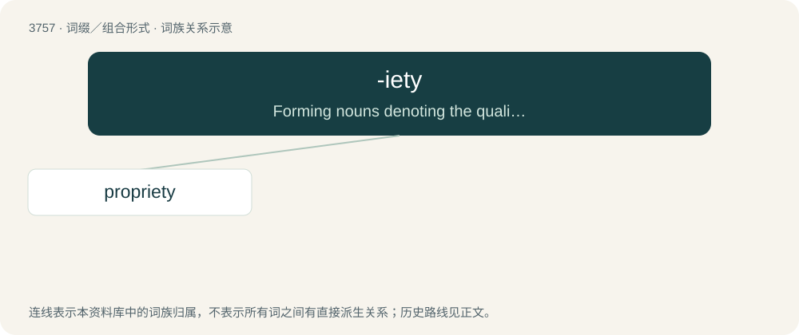

# 3795 · -iety — Forming nouns denoting the quality or condition of being what is indicated by the first element of the word.

[总目录](../00_总目录_按常用程度.md)

**类型**：词缀／组合形式　｜　**来源语言**：见词源记录

## 核心含义与来源

- 核心含义：Forming nouns denoting the quality or condition of being what is indicated by the first element of the word.
- 英文含义：Forming nouns denoting the quality or condition of being what is indicated by the first element of the word.
- 词形：-iety

**来源记录 1**（后缀／后置成分；Forming nouns denoting the quality or condition of being what is indicated by the first element of the word.）

From French -ieté or its source, Latin -ietas.

## 词族图

## 单词速览（常用到不常用）

| 单词 | 音标 | 释义 |
|---|---|---|
| [propriety](#w-1) | 英 /pɹəˈpɹaɪəti/ | n. 礼貌, 规矩, 适当；\[计\] 专有权 |

## 逐词详解

### 1. propriety

**词性**：名词　｜　**音标**：英 /pɹəˈpɹaɪəti/

**中文释义**：n. 礼貌, 规矩, 适当；\[计\] 专有权

**英文义项**：The particular character or essence of someone or something; individuality. / A characteristic; an attribute.

**构词拆分**：By surface analysis, prop(e)r + -iety

**词源与演化**：

From late Middle English proprietee, propretee, propriete (“ownership”), borrowed from Anglo-Norman propreté, Middle French proprieté, from Latin proprietās. By surface analysis, prop(e)r + -iety. Doublet of property.

**例句**：

> The way tourists dress offends the local standard of propriety.
