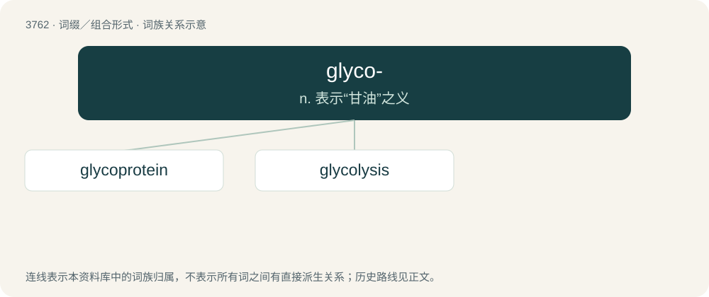

# 3798 · glyco- — n. 表示“甘油”之义

[总目录](../00_总目录_按常用程度.md)

**类型**：词缀／组合形式　｜　**来源语言**：见词源记录

## 核心含义与来源

- 核心含义：n. 表示“甘油”之义
- 英文含义：Sugars.
- 词形：glyco-

**来源记录 1**（前缀／前置成分；Sugars.）

From Ancient Greek γλυκύς (glukús, “sweet”).

## 词族图

## 单词速览（常用到不常用）

| 单词 | 音标 | 释义 |
|---|---|---|
| [glycoprotein](#w-1) | /,^laikəuˈprəutiːn/ | \[化\] 糖蛋白；\[医\] 糖蛋白 |
| [glycolysis](#w-2) | /ɡlaɪˈkɒlɪsɪs/ | n. 糖酵解(作用)；\[化\] 糖酵解 |

## 逐词详解

### 1. glycoprotein

**词性**：名词　｜　**音标**：/,^laikəuˈprəutiːn/

**中文释义**：\[化\] 糖蛋白；\[医\] 糖蛋白

**英文义项**：A protein with covalently bonded carbohydrates.

**构词拆分**：glyco- + protein

**词源与演化**：

From glyco- + protein.

### 2. glycolysis

**词性**：名词　｜　**音标**：/ɡlaɪˈkɒlɪsɪs/

**中文释义**：n. 糖酵解(作用)；\[化\] 糖酵解

**英文义项**：The cellular degradation of the simple sugar glucose to yield pyruvic acid (pyruvate), and ATP as an energy source

**构词拆分**：glyco- + -lysis

**词源与演化**：

From glyco- + -lysis.
