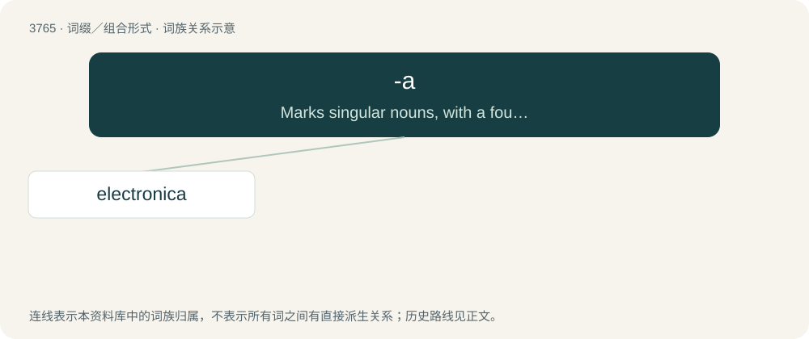

# 3800 · -a — Marks singular nouns, with a foundation in Greek or Latin, often implying femininity, especially when contrasted with words terminating in -us.

[总目录](../00_总目录_按常用程度.md)

**类型**：词缀／组合形式　｜　**来源语言**：见词源记录

## 核心含义与来源

- 核心含义：Marks singular nouns, with a foundation in Greek or Latin, often implying femininity, especially when contrasted with words terminating in -us.
- 英文含义：Marks singular nouns, with a foundation in Greek or Latin, often implying femininity, especially when contrasted with words terminating in -us.
- 词形：-a

**多个词源／构词路径**：同一拼写可能有不同来源；以下按词性和含义分别列出。

**来源记录 1**（后缀／后置成分；Marks singular nouns, with a foundation in Greek or Latin, often implying femininity, especially when contrasted with words terminating in -us.）

Learned borrowing from Latin -a (nominative first declension neuter singular suffix)

**来源记录 2**（后缀／后置成分；Marks nouns, with a foundation in Italian, Spanish, or Portuguese, implying femininity.）

Borrowed from Italian -a, Spanish -a and Portuguese -a, all feminine noun suffixes from Latin -a.

**来源记录 3**（后缀／后置成分；Added for metrical reasons to songs, poetry and verse, or as an empty filler syllable to other speech.）

Added especially for metrical reasons, or as an empty filler syllable.

**来源记录 4**（后缀／后置成分；to (infinitive marker)）

Contraction of to.

**来源记录 5**（后缀／后置成分；do (infinitive marker)）

Contraction of do.

## 词族图

## 单词速览（常用到不常用）

| 单词 | 音标 | 释义 |
|---|---|---|
| [electronica](#w-1) | /,ilekˈtrɔnikə/ | n. 电子乐, 电子音乐 |

## 逐词详解

### 1. electronica

**词性**：名词　｜　**音标**：/,ilekˈtrɔnikə/

**中文释义**：n. 电子乐, 电子音乐

**英文义项**：Any of a wide range of electronic music genres. / Electronic items in general.

**构词拆分**：electronic + -a

**词源与演化**：

From electronic + -a (“Latin singular suffix”).
