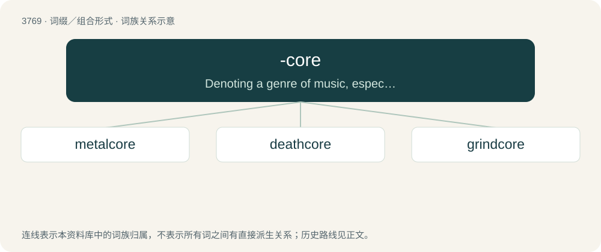

# 3804 · -core — Denoting a genre of music, especially one influenced by hardcore music.

[总目录](../00_总目录_按常用程度.md)

**类型**：词缀／组合形式　｜　**来源语言**：见词源记录

## 核心含义与来源

- 核心含义：Denoting a genre of music, especially one influenced by hardcore music.
- 英文含义：Denoting a genre of music, especially one influenced by hardcore music.
- 词形：-core

**来源记录 1**（后缀／后置成分；Denoting a genre of music, especially one influenced by hardcore music.）

Back-formation from hardcore (“hardcore punk, a particularly fast and intense form of punk rock”).

## 词族图

## 单词速览（常用到不常用）

| 单词 | 音标 | 释义 |
|---|---|---|
| [metalcore](#w-1) |  | 【英文】A subgenre of rock music which fuses extreme metal and hardcore punk. |
| [deathcore](#w-2) |  | 【英文】An extreme fusion genre of death metal and metalcore. |
| [grindcore](#w-3) |  | 【英文】A fusion genre of extreme metal and hardcore punk, incorporating aggressive guitar riffs; extremely rapid drumming; and loud, largely unintelligible screaming. |

## 逐词详解

### 1. metalcore

**词性**：名词

**英文义项**：A subgenre of rock music which fuses extreme metal and hardcore punk.

**构词拆分**：metal + -core

**词源与演化**：

From metal + -core.

**例句**：

> I've never heard metalcore like that.

### 2. deathcore

**词性**：名词

**英文义项**：An extreme fusion genre of death metal and metalcore.

**构词拆分**：death + -core

**词源与演化**：

From death + -core.

### 3. grindcore

**词性**：名词

**英文义项**：A fusion genre of extreme metal and hardcore punk, incorporating aggressive guitar riffs; extremely rapid drumming; and loud, largely unintelligible screaming.

**构词拆分**：grind + -core

**词源与演化**：

From grind + -core.
