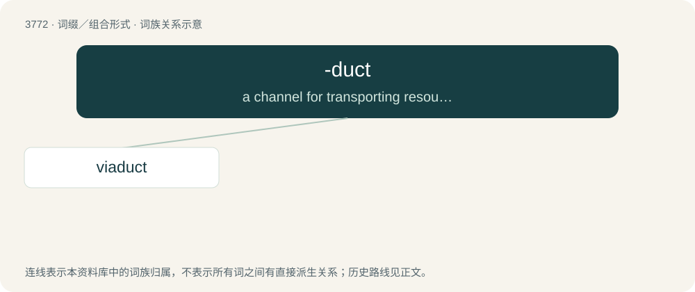

# 3806 · -duct — a channel for transporting resources

[总目录](../00_总目录_按常用程度.md)

**类型**：词缀／组合形式　｜　**来源语言**：见词源记录

## 核心含义与来源

- 核心含义：a channel for transporting resources
- 英文含义：a channel for transporting resources
- 词形：-duct

**来源记录 1**（后缀／后置成分；a channel for transporting resources）

From duct and aqueduct.

## 词族图

## 单词速览（常用到不常用）

| 单词 | 音标 | 释义 |
|---|---|---|
| [viaduct](#w-1) | 英 /ˈvaɪədʌkt/；美 /ˈvaɪəˌdʌk(t)/ | n. 高架桥 |

## 逐词详解

### 1. viaduct

**词性**：名词　｜　**音标**：英 /ˈvaɪədʌkt/；美 /ˈvaɪəˌdʌk(t)/

**中文释义**：n. 高架桥

**英文义项**：A bridge with several spans that carries rail or road traffic over a valley or other obstacles.

**词源与演化**：

Coined in 1816, from Latin via (“highway; road”) + English -duct, on the basis of aqueduct.

**例句**：

> They're building a new viaduct there.
