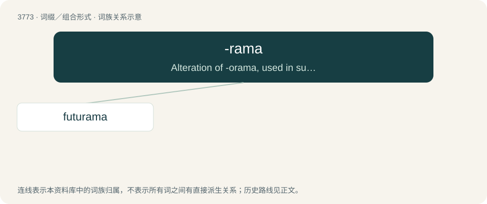

# 3807 · -rama — Alteration of -orama, used in suffixing a word ending with an r or vowel sound.

[总目录](../00_总目录_按常用程度.md)

**类型**：词缀／组合形式　｜　**来源语言**：见词源记录

## 核心含义与来源

- 核心含义：Alteration of -orama, used in suffixing a word ending with an r or vowel sound.
- 英文含义：Alteration of -orama, used in suffixing a word ending with an r or vowel sound.
- 词形：-rama

**来源记录 1**（后缀／后置成分；Alteration of -orama, used in suffixing a word ending with an r or vowel sound.）

A libfix, a modification of -orama, influenced by diorama and panorama, and thus indirectly derived from Ancient Greek ὅρᾱμᾰ (hórāmă, “sight, spectacle”).

## 词族图

## 单词速览（常用到不常用）

| 单词 | 音标 | 释义 |
|---|---|---|
| [futurama](#w-1) | /ˌfjuːt͡ʃəˈɹɑːmə/ | n. 未来世界展示 |

## 逐词详解

### 1. futurama

**词性**：名词　｜　**音标**：/ˌfjuːt͡ʃəˈɹɑːmə/

**中文释义**：n. 未来世界展示

**英文义项**：A palpable depiction of a (usually sensational) vision of the future.

**词源与演化**：

A generalised application of Futurama, the name of an exhibit-cum-ride at the 1939–40 New York World’s Fair that presented a possible model of the world twenty years thence (1959–60). The name of the exhibit derives from the English word future and the suffix -rama, meaning "a wide view of", which ultimately comes from the Ancient Greek word ὅρᾱμᾰ (hórāmă, “a sight”, “a spectacle”, “a speculation”) — as in panorama or diorama.
