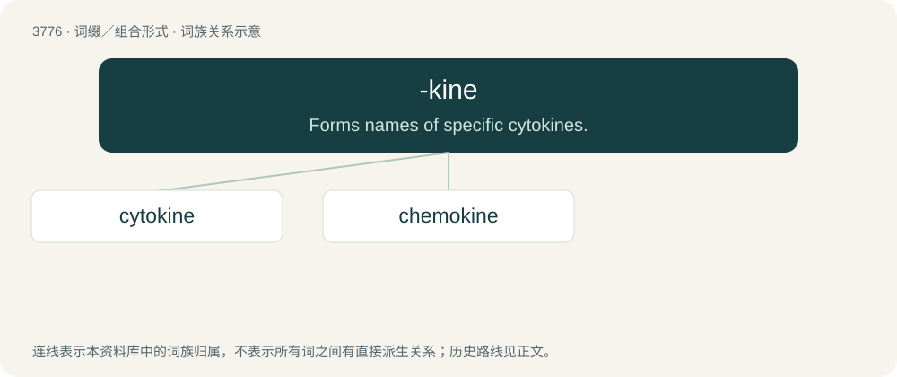

# 3808 · -kine — Forms names of specific cytokines.

[总目录](../00_总目录_按常用程度.md)

**类型**：词缀／组合形式　｜　**来源语言**：见词源记录

## 核心含义与来源

- 核心含义：Forms names of specific cytokines.
- 英文含义：Forms names of specific cytokines.
- 词形：-kine

**来源记录 1**（后缀／后置成分；Forms names of specific cytokines.）

From -kinesis or directly from Ancient Greek κινέω (kinéō, “to move”).

## 词族图

## 单词速览（常用到不常用）

| 单词 | 音标 | 释义 |
|---|---|---|
| [cytokine](#w-1) | 英 /ˈsaɪ.tə(ʊ)(ˌ)kaɪn/；美 /ˈsaɪ.təˌkaɪn/ | 细胞活素 |
| [chemokine](#w-2) | /kiːməʊˌkaɪn/ | 趋化因子 |

## 逐词详解

### 1. cytokine

**词性**：名词　｜　**音标**：英 /ˈsaɪ.tə(ʊ)(ˌ)kaɪn/；美 /ˈsaɪ.təˌkaɪn/

**中文释义**：细胞活素

**英文义项**：Any of various small regulatory proteins that regulate the cells of the immune system.

**构词拆分**：cyto- + -kine

**词源与演化**：

From cyto- + -kine from Ancient Greek κίνησις (kínēsis, “movement”).

### 2. chemokine

**词性**：名词　｜　**音标**：/kiːməʊˌkaɪn/

**中文释义**：趋化因子

**英文义项**：Any of various chemotactic cytokines, produced during inflammation, that organize the leukocytes.

**构词拆分**：chemo- + -kine

**词源与演化**：

From chemo- + -kine.
