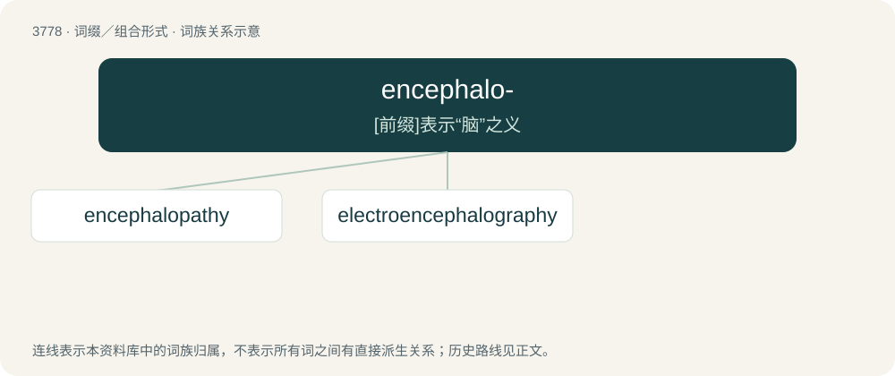

# 3811 · encephalo- — \[前缀\]表示“脑”之义

[总目录](../00_总目录_按常用程度.md)

**类型**：词缀／组合形式　｜　**来源语言**：见词源记录

## 核心含义与来源

- 核心含义：\[前缀\]表示“脑”之义
- 英文含义：Pertaining to the brain.
- 词形：encephalo-

**来源记录 1**（前缀／前置成分；Pertaining to the brain.）

From en- + cephalo-. From Ancient Greek ἐγκέφαλος (enképhalos, “brain”) (within the head), from ἐν (en, “in”) + κεφαλή (kephalḗ, “head”).

## 词族图

## 单词速览（常用到不常用）

| 单词 | 音标 | 释义 |
|---|---|---|
| [encephalopathy](#w-1) | /ɛnˌsɛfəˈlɒpəθi/ | n. 脑病；\[医\] 脑病 |
| [electroencephalography](#w-2) | /əlɛktɹəʊɛnsɛfəˈlɒɡɹəfi/ | n. 脑电图记录, 脑电图；\[计\] 脑电图显示, 脑电图描记术 |

## 逐词详解

### 1. encephalopathy

**词性**：名词　｜　**音标**：/ɛnˌsɛfəˈlɒpəθi/

**中文释义**：n. 脑病；\[医\] 脑病

**英文义项**：Any of various conditions affecting the brain.

**构词拆分**：encephalo- + -pathy

**词源与演化**：

From encephalo- + -pathy.

### 2. electroencephalography

**词性**：名词　｜　**音标**：/əlɛktɹəʊɛnsɛfəˈlɒɡɹəfi/

**中文释义**：n. 脑电图记录, 脑电图；\[计\] 脑电图显示, 脑电图描记术

**英文义项**：The measurement and recording of electrical activity in the brain for diagnostic purposes.

**构词拆分**：electro- + encephalo- + -graphy

**词源与演化**：

From electro- + encephalo- + -graphy.
