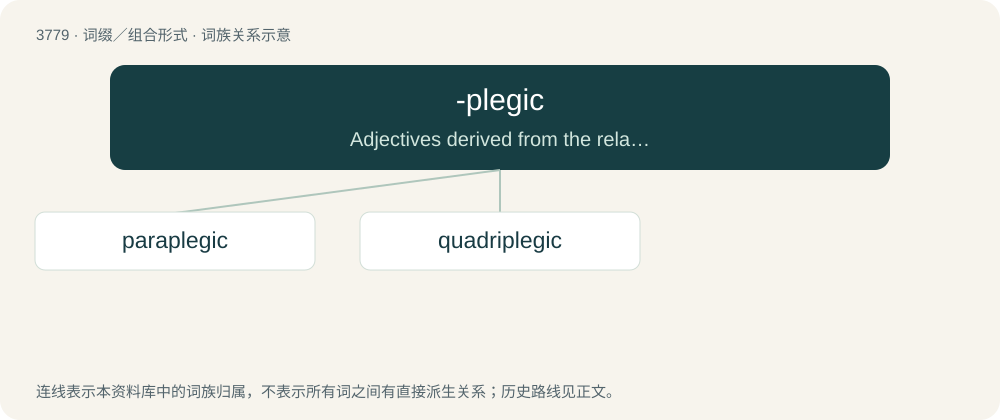

# 3812 · -plegic — Adjectives derived from the related -plegia

[总目录](../00_总目录_按常用程度.md)

**类型**：词缀／组合形式　｜　**来源语言**：见词源记录

## 核心含义与来源

- 核心含义：Adjectives derived from the related -plegia
- 英文含义：Adjectives derived from the related -plegia
- 词形：-plegic

## 词族图

## 单词速览（常用到不常用）

| 单词 | 音标 | 释义 |
|---|---|---|
| [paraplegic](#w-1) | 美 /ˌpɛɹəˈplid͡ʒɪk/ | a. 下身麻痹的；n. 下身麻痹患者 |
| [quadriplegic](#w-2) | 英 /ˌkwɒd.ɹɪˈp(ə)liː.dʒɪk/；美 /ˌkwɑdɹɪˈp(ə)lid͡ʒɪk/ | n. 四肢瘫痪者；a. 四肢瘫痪的 |

## 逐词详解

### 1. paraplegic

**词性**：形容词　｜　**音标**：美 /ˌpɛɹəˈplid͡ʒɪk/

**中文释义**：a. 下身麻痹的；n. 下身麻痹患者

**英文义项**：Of, related to, or suffering from paraplegia. Paralyzed from the lower half of the body down.

**构词拆分**：para- + -plegic

**词源与演化**：

From para- + -plegic.

**例句**：

> He's paraplegic, which means he can't use his legs to walk.

### 2. quadriplegic

**词性**：形容词　｜　**音标**：英 /ˌkwɒd.ɹɪˈp(ə)liː.dʒɪk/；美 /ˌkwɑdɹɪˈp(ə)lid͡ʒɪk/

**中文释义**：n. 四肢瘫痪者；a. 四肢瘫痪的

**英文义项**：Of, related to, or suffering from quadriplegia.

**词源与演化**：

From quadri- (of Latin origins) and -plegic, from Ancient Greek πλήσσειν (plḗssein, “to strike”); probably patterned after paraplegic from the Ancient Greek παραπληγή (paraplēgḗ, “the paralysis of half of the body”).
