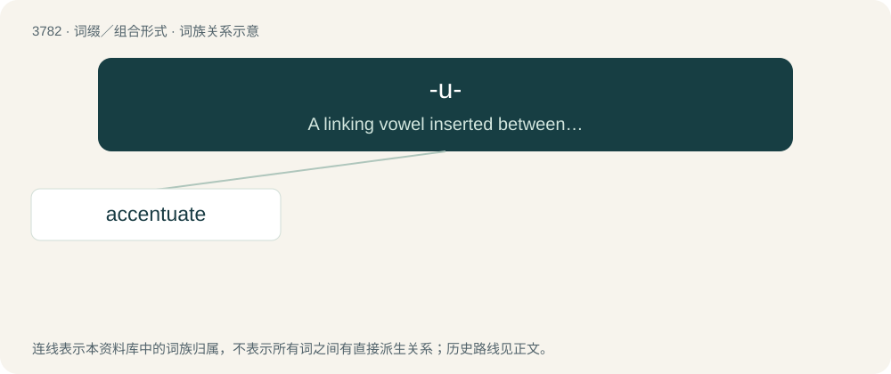

# 3813 · -u- — A linking vowel inserted between two morphemes, to ease pronunciation, without contributing to the meaning.

[总目录](../00_总目录_按常用程度.md)

**类型**：词缀／组合形式　｜　**来源语言**：见词源记录

## 核心含义与来源

- 核心含义：A linking vowel inserted between two morphemes, to ease pronunciation, without contributing to the meaning.
- 英文含义：A linking vowel inserted between two morphemes, to ease pronunciation, without contributing to the meaning.
- 词形：-u-

**多个词源／构词路径**：同一拼写可能有不同来源；以下按词性和含义分别列出。

**来源记录 1**（interfix；A linking vowel inserted between two morphemes, to ease pronunciation, without contributing to the meaning.）

From Latin -u-.

**来源记录 2**（infix；a monoclonal antibody derived from a human source.）

From the initial vowel of human.

## 词族图

## 单词速览（常用到不常用）

| 单词 | 音标 | 释义 |
|---|---|---|
| [accentuate](#w-1) | 英 /əkˈsɛn.t͡ʃu.eɪt/ | vt. 以重音念, 强调, 重读 |

## 逐词详解

### 1. accentuate

**词性**：动词　｜　**音标**：英 /əkˈsɛn.t͡ʃu.eɪt/

**中文释义**：vt. 以重音念, 强调, 重读

**英文义项**：To pronounce with an accent or vocal stress. / To bring out distinctly; to make more noticeable or prominent; to emphasize.

**构词拆分**：accent + -u- + -ate

**词源与演化**：

First attested in 1731; borrowed from Medieval Latin accentuātus, perfect passive participle of accentuō (see -ate (verb-forming suffix)), from Latin accentus. accent + -u- + -ate.

**例句**：

> Carmela's high cheekbones accentuate her facial structure, enhancing her natural beauty.
