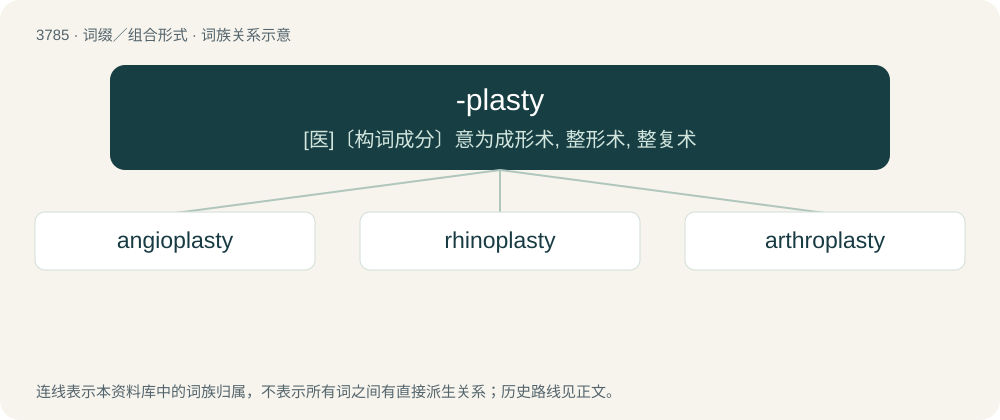

# 3818 · -plasty — \[医\]〔构词成分〕意为成形术, 整形术, 整复术

[总目录](../00_总目录_按常用程度.md)

**类型**：词缀／组合形式　｜　**来源语言**：见词源记录

## 核心含义与来源

- 核心含义：\[医\]〔构词成分〕意为成形术, 整形术, 整复术
- 英文含义：Repair or restoration of a part or function.
- 词形：-plasty

**来源记录 1**（后缀／后置成分；Repair or restoration of a part or function.）

Derived from Ancient Greek πλᾰστός (plăstós, “molded, formed”).

## 词族图

## 单词速览（常用到不常用）

| 单词 | 音标 | 释义 |
|---|---|---|
| [angioplasty](#w-1) | /ˈæn.d͡ʒi.əʊ.plæs.ti/ | \[医\] 血管成形术 |
| [rhinoplasty](#w-2) | /ˈrainəplæsti/ | n. 鼻整形术；\[医\] 鼻成形术 |
| [arthroplasty](#w-3) | /ˈɑːθrə,plæsti/ | \[医\] 关节成形术 |

## 逐词详解

### 1. angioplasty

**词性**：名词　｜　**音标**：/ˈæn.d͡ʒi.əʊ.plæs.ti/

**中文释义**：\[医\] 血管成形术

**英文义项**：The mechanical widening of a narrowed or totally obstructed blood vessel generally caused by atheroma.

**构词拆分**：angio- + -plasty

**词源与演化**：

From angio- + -plasty.

### 2. rhinoplasty

**词性**：名词　｜　**音标**：/ˈrainəplæsti/

**中文释义**：n. 鼻整形术；\[医\] 鼻成形术

**英文义项**：A type of plastic surgery that is used to improve the function (reconstructive surgery) or appearance (cosmetic surgery) of a person's nose. / An instance of such surgery; one operation (procedure).

**构词拆分**：rhino- + -plasty

**词源与演化**：

From rhino- + -plasty.

**例句**：

> Martha wanted a rhinoplasty and lip augmentation.

### 3. arthroplasty

**词性**：名词　｜　**音标**：/ˈɑːθrə,plæsti/

**中文释义**：\[医\] 关节成形术

**英文义项**：The surgical repair of a joint, or creation of an artificial joint, such as a hip replacement.

**构词拆分**：arthro- + -plasty

**词源与演化**：

From arthro- + -plasty.
