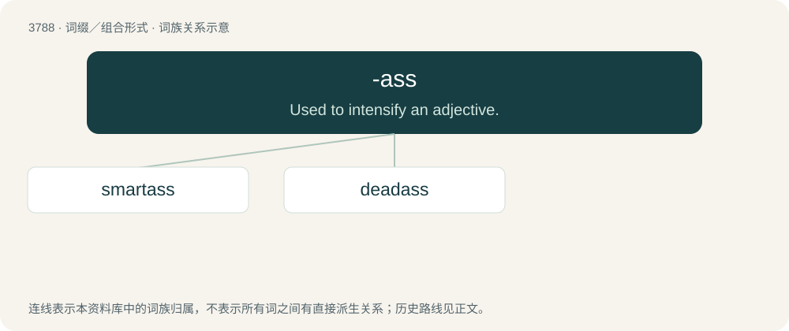

# 3820 · -ass — Used to intensify an adjective.

[总目录](../00_总目录_按常用程度.md)

**类型**：词缀／组合形式　｜　**来源语言**：见词源记录

## 核心含义与来源

- 核心含义：Used to intensify an adjective.
- 英文含义：Used to intensify an adjective.
- 词形：-ass

**来源记录 1**（后缀／后置成分；Used to intensify an adjective.）

Partially from ass, and partially from a corruption or simplification of assed.

## 词族图

## 单词速览（常用到不常用）

| 单词 | 音标 | 释义 |
|---|---|---|
| [smartass](#w-1) |  | 【英文】An insolent person, especially one who makes snide remarks. |
| [deadass](#w-2) | /ˈdedˈæs/ | n. 大笨蛋,头号傻瓜 |

## 逐词详解

### 1. smartass

**词性**：名词

**英文义项**：An insolent person, especially one who makes snide remarks. / Synonym of know-it-all, an obnoxious clever person or a person making obnoxious efforts to seem clever by acting or behaving as if they know everything.

**构词拆分**：From smart + -ass.

**词源与演化**：

From smart + -ass.

**例句**：

> Lots of luck, smartass.

该用例对应义项：An insolent person, especially one who makes snide remarks.

### 2. deadass

**词性**：形容词　｜　**音标**：/ˈdedˈæs/

**中文释义**：n. 大笨蛋,头号傻瓜

**英文义项**：Having very little activity; dead. / Genuine; real. Used as a negative intensifier.

**构词拆分**：dead + -ass (“used to intensify an adjective”)；dead serious + -ass

**词源与演化**：

From dead + -ass (“used to intensify an adjective”). Some senses from an ellipsis of dead-ass serious, from dead serious + -ass. Originated in New York City, and popularized around the late 1990s–2000s.

**例句**：

> You need to quit talking about my mama. I'm deadass.

该用例对应义项：Dead serious.
