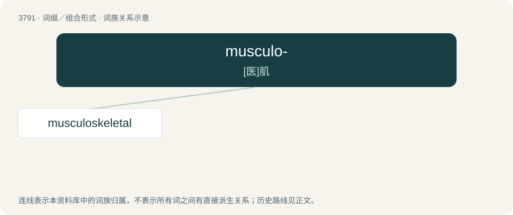

# 3821 · musculo- — \[医\]肌

[总目录](../00_总目录_按常用程度.md)

**类型**：词缀／组合形式　｜　**来源语言**：见词源记录

## 核心含义与来源

- 核心含义：\[医\]肌
- 英文含义：muscle
- 词形：musculo-

## 词族图

## 单词速览（常用到不常用）

| 单词 | 音标 | 释义 |
|---|---|---|
| [musculoskeletal](#w-1) | /,mʌskjuləuˈskelitəl/ | a. 肌与骨骼的；\[医\] 肌\[与\]骨胳的 |

## 逐词详解

### 1. musculoskeletal

**词性**：形容词　｜　**音标**：/,mʌskjuləuˈskelitəl/

**中文释义**：a. 肌与骨骼的；\[医\] 肌\[与\]骨胳的

**英文义项**：Of, or relating to both muscles and the skeleton.

**构词拆分**：musculo- + skeletal

**词源与演化**：

From musculo- + skeletal.
