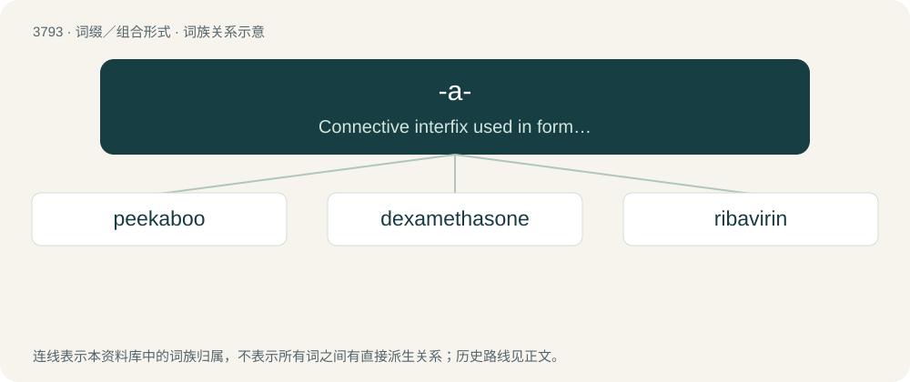

# 3825 · -a- — Connective interfix used in forming compounds, often no longer carrying a distinct meaning.

[总目录](../00_总目录_按常用程度.md)

**类型**：词缀／组合形式　｜　**来源语言**：见词源记录

## 核心含义与来源

- 核心含义：Connective interfix used in forming compounds, often no longer carrying a distinct meaning.
- 英文含义：Connective interfix used in forming compounds, often no longer carrying a distinct meaning.
- 词形：-a-

**多个词源／构词路径**：同一拼写可能有不同来源；以下按词性和含义分别列出。

**来源记录 1**（interfix；Connective interfix used in forming compounds, often no longer carrying a distinct meaning.）

From of a (as in half-a-crown) or of (as in jack-a-napes from Middle English Jak of Naples). Some terms have fully incorporated the use, as ragamuffin and jackanape(s); others arise from mistaken assimilation to the form, as all-a-gog and cock-a-leekie.

**来源记录 2**（连词；And）

From earlier a (attested by the 14th c.), as a contraction of and and its various Middle English forms.

**来源记录 3**（infix；Connective infix encountered in loanwords and phrases, generally no longer carrying a distinct meaning.）

From French à (“various prepositions”) and related prepositions in other Romance languages. Also from related misunderstandings, as all-a-mort from French à la morte.

**来源记录 4**（infix；A monoclonal antibody derived from a rat.）

Clipping of rat.

## 词族图

## 单词速览（常用到不常用）

| 单词 | 音标 | 释义 |
|---|---|---|
| [peekaboo](#w-1) | 美 /ˈpikəbu/ | n. &lt;主美&gt;躲躲猫(一种把脸一隐一现以逗小孩的游戏) |
| [dexamethasone](#w-2) | 英 /ˌdɛk.səˈmɛθ.ə.səʊn/；美 /ˌdɛk.səˈmɛθ.əˌsoʊn/ | \[化\] 地塞米松；\[医\] 地塞米松, 氟甲强的松龙, 9α-氟-16α-甲基强的松龙 |
| [ribavirin](#w-3) | /ˌɹaɪ.bəˈvaɪ.ɹɪn/ | \[化\] 利巴韦林; 三氮唑核苷 |

## 逐词详解

### 1. peekaboo

**词性**：形容词　｜　**音标**：美 /ˈpikəbu/

**中文释义**：n. &lt;主美&gt;躲躲猫(一种把脸一隐一现以逗小孩的游戏)

**英文义项**：With holes, slits or transparent fabric to reveal what is normally hidden. / Being or using a style of boxing with the hands kept close to the face to defend it.

**构词拆分**：From peek + -a- + boo.

**词源与演化**：

From peek + -a- + boo.

**例句**：

> The model was wearing a peekaboo swimsuit.

该用例对应义项：With holes, slits or transparent fabric to reveal what is normally hidden.

### 2. dexamethasone

**词性**：名词　｜　**音标**：英 /ˌdɛk.səˈmɛθ.ə.səʊn/；美 /ˌdɛk.səˈmɛθ.əˌsoʊn/

**中文释义**：\[化\] 地塞米松；\[医\] 地塞米松, 氟甲强的松龙, 9α-氟-16α-甲基强的松龙

**英文义项**：A synthetic member of the glucocorticoid-class of steroid hormones, having the chemical formula C₂₂H₂₉FO₅, and used especially as an anti-inflammatory agent.

**构词拆分**：From dex- + -a- + -methasone (“prednisone or prednisolone derivative”).

**词源与演化**：

From dex- + -a- + -methasone (“prednisone or prednisolone derivative”).

**例句**：

> Many dexamethasones act as anti-inflammatory agents.

该用例对应义项：A synthetic member of the glucocorticoid-class of steroid hormones, having the chemical formula C₂₂H₂₉FO₅, and used especially as an anti-inflammatory agent.

### 3. ribavirin

**词性**：名词　｜　**音标**：/ˌɹaɪ.bəˈvaɪ.ɹɪn/

**中文释义**：\[化\] 利巴韦林; 三氮唑核苷

**英文义项**：A synthetic analog of guanosine with chemical formula C₈H₁₂N₄O₅ that inhibits viral nucleic acid synthesis and is used as a broad-spectrum antiviral drug especially in the treatment of respiratory syncytial virus infection and chronic hepatitis C.

**构词拆分**：riboside + -a- + -vir- + -in

**词源与演化**：

From rib(oside) + -a- + -vir- (“antiviral”) + -in.
