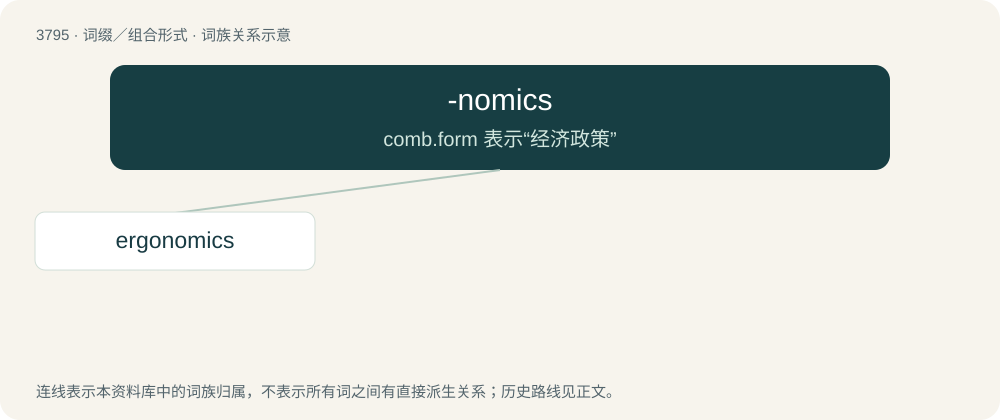

# 3830 · -nomics — comb.form 表示“经济政策”

[总目录](../00_总目录_按常用程度.md)

**类型**：词缀／组合形式　｜　**来源语言**：见词源记录

## 核心含义与来源

- 核心含义：comb.form 表示“经济政策”
- 英文含义：The rules of a discipline.
- 词形：-nomics

**多个词源／构词路径**：同一拼写可能有不同来源；以下按词性和含义分别列出。

**来源记录 1**（后缀／后置成分；The rules of a discipline.）

From Ancient Greek νόμος (nómos, “law”). The addition of an English prefix thus indicates the "laws" of the discipline or area denoted by the prefix. By surface analysis, -nomy + -ics.

**来源记录 2**（后缀／后置成分；Used to form nouns meaning the economics, economic practises, or economic philosophy of a specified person or state.）

Back-formation from economics.

## 词族图

## 单词速览（常用到不常用）

| 单词 | 音标 | 释义 |
|---|---|---|
| [ergonomics](#w-1) | 英 /ɜː.ɡəˈnɒm.ɪks/；美 /ˌɝ.ɡəˈnɑ.mɪks/ | n. 工效学, 人类工程学；\[化\] 工效学 |

## 逐词详解

### 1. ergonomics

**词性**：名词　｜　**音标**：英 /ɜː.ɡəˈnɒm.ɪks/；美 /ˌɝ.ɡəˈnɑ.mɪks/

**中文释义**：n. 工效学, 人类工程学；\[化\] 工效学

**英文义项**：The science of the design of equipment, especially so as to reduce operator fatigue, discomfort and injury. / Political economy.

**构词拆分**：ergo- + -nomics；ergo- (prefix indicating work) + -nomics (suffix indicating the rules of a discipline)

**词源与演化**：

From ergo- (prefix indicating work) + -nomics (suffix indicating the rules of a discipline), probably modelled after Polish ergonomia (“ergonomics”) (used by Polish scientist Wojciech Jastrzębowski (1799–1882) in an 1857 article), from Ancient Greek ἔργον (érgon, “work”) + νόμος (nómos, “custom; law, ordinance”). The English word is widely regarded as having been introduced by British psychologist K. F. Hywel Murrell at a meeting at the Admiralty in London in July 1949, which led to the establishment of the Ergonomics Research Society (now The Chartered Institute of Ergonomics and Human Factors) on 17 September 1949.

**例句**：

> Ergonomics is increasingly important in office-product design.

该用例对应义项：The science of the design of equipment, especially so as to reduce operator fatigue, discomfort and injury.
