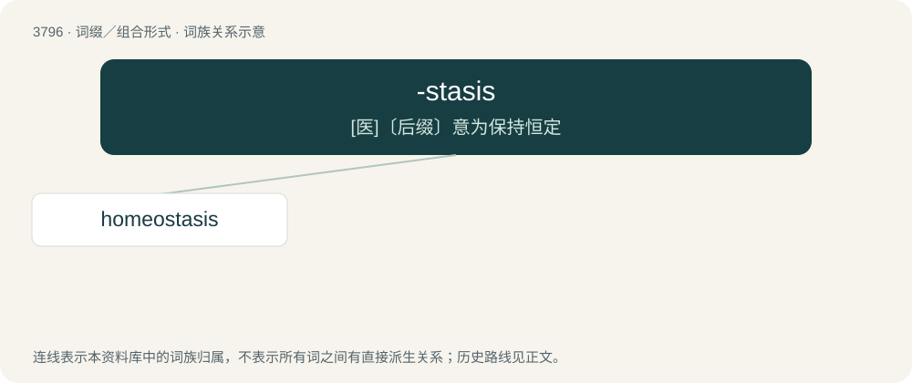

# 3831 · -stasis — \[医\]〔后缀〕意为保持恒定

[总目录](../00_总目录_按常用程度.md)

**类型**：词缀／组合形式　｜　**来源语言**：见词源记录

## 核心含义与来源

- 核心含义：\[医\]〔后缀〕意为保持恒定
- 英文含义：slowing down, stopping.
- 词形：-stasis

**来源记录 1**（后缀／后置成分；slowing down, stopping.）

From stasis.

## 词族图

## 单词速览（常用到不常用）

| 单词 | 音标 | 释义 |
|---|---|---|
| [homeostasis](#w-1) | 英 /ˌhɒmɪə(ʊ)ˈsteɪsɪs/；美 /ˌhoʊ.mi.oʊˈsteɪ.sɪs/ | n. 体内平衡, 内环境稳定；\[计\] 动态静止; 动态平衡 |

## 逐词详解

### 1. homeostasis

**词性**：名词　｜　**音标**：英 /ˌhɒmɪə(ʊ)ˈsteɪsɪs/；美 /ˌhoʊ.mi.oʊˈsteɪ.sɪs/

**中文释义**：n. 体内平衡, 内环境稳定；\[计\] 动态静止; 动态平衡

**英文义项**：The ability of a system or living organism to adjust its internal environment to maintain a state of dynamic constancy; such as the ability of warm-blooded animals to maintain a stable temperature. / Such a dynamic equilibrium or balance.

**构词拆分**：Ancient Greek ὅμοιος (hómoios, “similar, the same”) + -stasis

**词源与演化**：

Coined from Ancient Greek ὅμοιος (hómoios, “similar, the same”) + -stasis by Walter Bradford Cannon, from Ancient Greek στάσις (stásis, “standing, state”).

**例句**：

> Adaptogens are used in herbal medicine for the purported stabilization of physiological processes and promotion of homeostasis.
