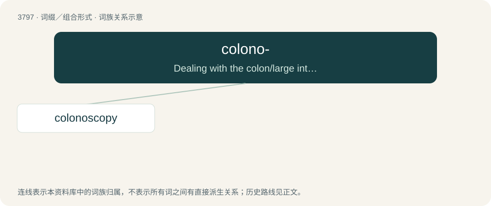

# 3832 · colono- — Dealing with the colon/large intestine.

[总目录](../00_总目录_按常用程度.md)

**类型**：词缀／组合形式　｜　**来源语言**：见词源记录

## 核心含义与来源

- 核心含义：Dealing with the colon/large intestine.
- 英文含义：Dealing with the colon/large intestine.
- 词形：colono-

## 词族图

## 单词速览（常用到不常用）

| 单词 | 音标 | 释义 |
|---|---|---|
| [colonoscopy](#w-1) | 英 /ˌkɒ.ləˈnɒ.skə.pi/；美 /kɑ.ləˈnɑ.skə.pi/ | n. 结肠镜检查；\[医\] 结肠镜检查 |

## 逐词详解

### 1. colonoscopy

**词性**：名词　｜　**音标**：英 /ˌkɒ.ləˈnɒ.skə.pi/；美 /kɑ.ləˈnɑ.skə.pi/

**中文释义**：n. 结肠镜检查；\[医\] 结肠镜检查

**英文义项**：The examination of the colon using a colonoscope.

**构词拆分**：colono- + -scopy

**词源与演化**：

From colono- + -scopy.

**例句**：

> I had a colonoscopy and upper abdominal endoscopy.
