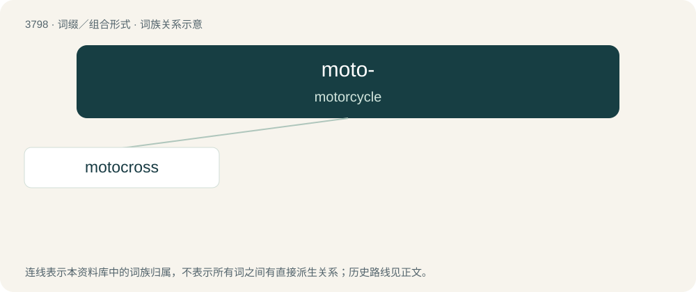

# 3833 · moto- — motorcycle

[总目录](../00_总目录_按常用程度.md)

**类型**：词缀／组合形式　｜　**来源语言**：见词源记录

## 核心含义与来源

- 核心含义：motorcycle
- 英文含义：motorcycle
- 词形：moto-

## 词族图

## 单词速览（常用到不常用）

| 单词 | 音标 | 释义 |
|---|---|---|
| [motocross](#w-1) | 英 /ˈməʊ.tə(ʊ).kɹɒs/；美 /ˈmoʊ.doʊˌkɹɔs/ | n. 摩托车越野赛 |

## 逐词详解

### 1. motocross

**词性**：名词　｜　**音标**：英 /ˈməʊ.tə(ʊ).kɹɒs/；美 /ˈmoʊ.doʊˌkɹɔs/

**中文释义**：n. 摩托车越野赛

**英文义项**：A form of off-road motorbike racing. / An event where such racing takes place.

**构词拆分**：moto- + -cross

**词源与演化**：

Unadapted borrowing from French motocross, a macaronic blend of moto, from motocyclette (“motorcycle”) and English cross-country. May be decomposed as moto- + -cross.

**例句**：

> Tom is a fan of bicycle motocross, or BMX.
