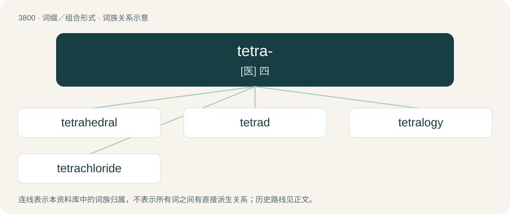

# 3834 · tetra- — \[医\] 四

[总目录](../00_总目录_按常用程度.md)

**类型**：词缀／组合形式　｜　**来源语言**：见词源记录

## 核心含义与来源

- 核心含义：\[医\] 四
- 英文含义：Four.
- 词形：tetra-

**来源记录 1**（前缀／前置成分；Four.）

Borrowed from Ancient Greek τετρα- (tetra-), combining form of Ancient Greek τέτταρες (téttares), from τέσσαρες (téssares, “four”). Doublet of quadri-.

## 词族图

## 单词速览（常用到不常用）

| 单词 | 音标 | 释义 |
|---|---|---|
| [tetrahedral](#w-1) | /ˌtɛ.tɹəˈhiː.dɹəl/ | a. 有四面的, 四面体的 |
| [tetrad](#w-2) | 英 /ˈtɛtɹæd/ | n. 四元组, 四个一组, 四分染色体；\[计\] 四位组 |
| [tetralogy](#w-3) | /tɛˈtɹæləd͡ʒi/ | n. 四部曲, 四联剧；\[医\] 甲联症 |
| [tetrachloride](#w-4) | /,tetrəˈklɔːraid/ | \[医\] 四氯化物 |

## 逐词详解

### 1. tetrahedral

**词性**：形容词　｜　**音标**：/ˌtɛ.tɹəˈhiː.dɹəl/

**中文释义**：a. 有四面的, 四面体的

**英文义项**：Of, relating to, or having the shape of a tetrahedron.

**构词拆分**：tetra- + -hedral

**词源与演化**：

From tetra- + -hedral.

**例句**：

> A methane molecule has a tetrahedral structure.

### 2. tetrad

**词性**：名词　｜　**音标**：英 /ˈtɛtɹæd/

**中文释义**：n. 四元组, 四个一组, 四分染色体；\[计\] 四位组

**英文义项**：A group of four things. / Two pairs of sister chromatids (a dyad pair) aligned in a certain way and often on the equatorial plane during the meiosis process.

**构词拆分**：tetra- + -ad

**词源与演化**：

From Ancient Greek τετράς (tetrás), analysable as tetra- + -ad.

### 3. tetralogy

**词性**：名词　｜　**音标**：/tɛˈtɹæləd͡ʒi/

**中文释义**：n. 四部曲, 四联剧；\[医\] 甲联症

**英文义项**：A set of four works of art that are connected, and that can be seen either as a single work or as four individual works. They are commonly found in literature, film, or video games. / A group of four dramas, three tragic and one satiric, exhibited together at the festivals of Dionysus at Athens.

**构词拆分**：tetra- + -logy

**词源与演化**：

From tetra- + -logy.

### 4. tetrachloride

**词性**：名词　｜　**音标**：/,tetrəˈklɔːraid/

**中文释义**：\[医\] 四氯化物

**英文义项**：any chloride containing four chlorine atoms in each molecule

**构词拆分**：tetra- + chloride

**词源与演化**：

From tetra- + chloride.
