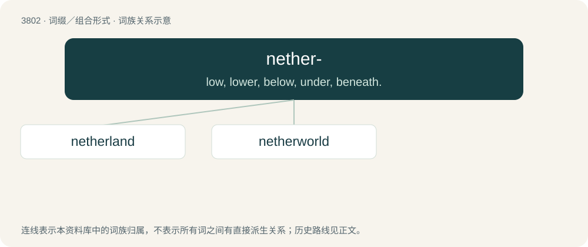

# 3836 · nether- — low, lower, below, under, beneath.

[总目录](../00_总目录_按常用程度.md)

**类型**：词缀／组合形式　｜　**来源语言**：见词源记录

## 核心含义与来源

- 核心含义：low, lower, below, under, beneath.
- 英文含义：low, lower, below, under, beneath.
- 词形：nether-

**来源记录 1**（前缀／前置成分；low, lower, below, under, beneath.）

From Middle English nither-, neother-, from Old English niþer- (prefix), from niþer (“below, beneath, down, downwards, lower, in an inferior position”). Cognate with Dutch neder-, neer- (“down”), German nieder- (“down”). More at nether.

## 词族图

## 单词速览（常用到不常用）

| 单词 | 音标 | 释义 |
|---|---|---|
| [netherland](#w-1) |  | 【英文】A supposed place to which one's spirit descends upon death; the netherworld. |
| [netherworld](#w-2) |  | n. 阴间, 下层社会 |

## 逐词详解

### 1. netherland

**词性**：名词

**英文义项**：A supposed place to which one's spirit descends upon death; the netherworld.

**构词拆分**：nether- + land

**词源与演化**：

From nether- + land.

### 2. netherworld

**词性**：名词

**中文释义**：n. 阴间, 下层社会

**英文义项**：The place to which one's spirit descends upon death, conceived as below the surface of the earth. / The locale of the spirit world or afterlife, whether deemed to be situated below the world of the living or not.

**构词拆分**：nether- + world

**词源与演化**：

From nether- (“beneath, lower”) + world.

**例句**：

> While I was astrally projecting, I felt my soul pass through many insubstantial netherworlds.

该用例对应义项：The locale of the spirit world or afterlife, whether deemed to be situated below the world of the living or not.
